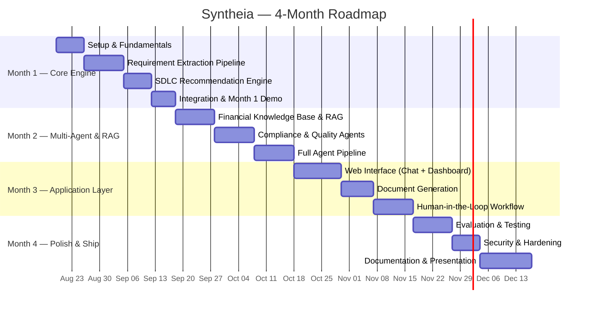
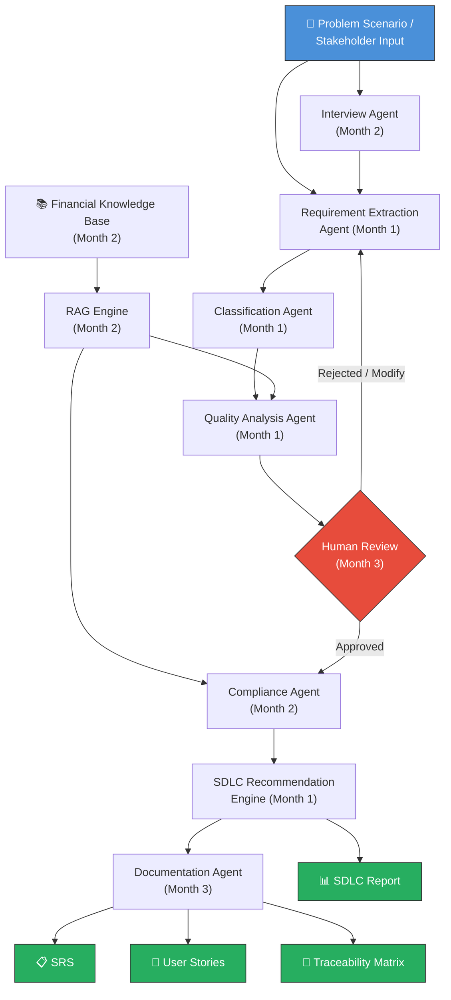
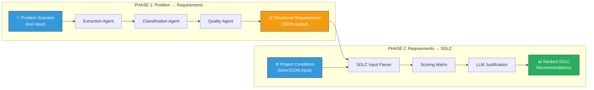
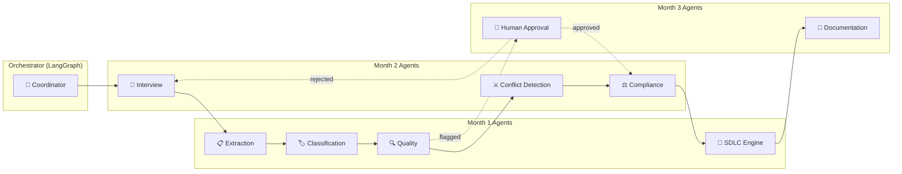

# Syntheia — 4-Month Implementation Plan
## Agentic AI for Automated Requirement Gathering, Analysis & SDLC Identification in Financial Services

---

## Project Timeline Overview



### Month-End Deliverables

| Month | Deliverable | Status |
|-------|------------|--------|
| **Month 1** | **Phase 1:** Input a problem scenario → get structured requirements (extracted, classified, quality-checked). **Phase 2:** Input requirements + project conditions → get ranked SDLC recommendation with justification. | 🎯 First Checkpoint |
| **Month 2** | RAG-grounded agents, compliance mapping, conflict detection, full multi-agent LangGraph pipeline working end-to-end | Building depth |
| **Month 3** | Web application (chat UI, dashboard, approval workflow), document generation (SRS, user stories, RTM) | User-facing product |
| **Month 4** | Evaluation on multiple scenarios, security controls, complete documentation, presentation, final demo | Ship it |

---

## 1. Project Understanding

### Problem Being Solved

Financial institutions gather software requirements manually from diverse stakeholders (customers, compliance officers, developers, regulators). This process is **slow, ambiguous, inconsistent**, and frequently misses regulatory/security requirements — leading to scope creep, compliance gaps, costly rework, and unsuitable development practices.

### Objectives

Build a **multi-agent AI platform** that:
1. Conducts adaptive stakeholder interviews
2. Extracts and structures requirements from conversations and documents
3. Classifies requirements across 13+ dimensions (business, security, compliance, etc.)
4. Detects ambiguity, conflicts, incompleteness, and duplication
5. Maps requirements to financial regulations and organisational policies
6. Recommends an appropriate SDLC model with justification
7. Generates structured artefacts (SRS, user stories, traceability matrix, etc.)
8. Maintains human-in-the-loop approval gates throughout

### Expected Inputs & Outputs

**Inputs:**
- Stakeholder conversations / interview transcripts / problem scenarios
- Policy documents, regulatory texts, existing requirement docs
- Questionnaire responses, emails, meeting notes
- Project conditions (team size, timeline, regulatory environment, change frequency)

**Outputs:**
- Structured requirements (ID, statement, category, source, priority, dependencies, etc.)
- Software Requirements Specification (SRS)
- User stories with acceptance criteria
- Compliance-control matrix & risk register
- Requirements Traceability Matrix (RTM)
- Ranked SDLC recommendations with justification
- Project-specific SDLC workflow

---

### Requirement Classification by Month

#### Month 1 — MVP Core (First Deliverable)

| # | Requirement |
|---|-------------|
| 1 | Requirement extraction from problem scenarios / text input |
| 2 | Multi-label requirement classification (13 categories) |
| 3 | Basic quality analysis (ambiguity, completeness flags) |
| 4 | Structured output with requirement IDs, categories, priorities |
| 5 | SDLC recommendation engine (input: requirements + project conditions → output: ranked SDLC models) |
| 6 | CLI or notebook-based interface (functional, not pretty) |
| 7 | One financial domain test case (loan processing) |

#### Month 2 — Multi-Agent & RAG

| # | Requirement |
|---|-------------|
| 1 | RAG pipeline with financial knowledge base |
| 2 | Compliance mapping agent (requirements → regulations) |
| 3 | Conflict and duplication detection |
| 4 | Confidence scoring on all outputs |
| 5 | Full LangGraph multi-agent orchestration |
| 6 | Adaptive interview agent (conversational) |

#### Month 3 — Application Layer

| # | Requirement |
|---|-------------|
| 1 | Web interface (chat + dashboard) |
| 2 | Human approval workflow (accept/reject/modify) |
| 3 | SRS document generation |
| 4 | User story generation |
| 5 | Requirements Traceability Matrix |
| 6 | Document download (DOCX/PDF) |

#### Month 4 — Polish & Ship

| # | Requirement |
|---|-------------|
| 1 | Evaluation on 3+ financial scenarios |
| 2 | Role-based access control |
| 3 | Audit logging |
| 4 | Sensitive data masking |
| 5 | Complete documentation |
| 6 | Final presentation & demo |

### Critical Assessment

> [!WARNING]
> **The problem statement describes a production-grade enterprise platform.** With 4 months, we can build a **strong, convincing prototype** — not a production system. The key is to have the core intelligence working brilliantly (Months 1–2) before investing in UI and polish (Months 3–4).

> [!IMPORTANT]
> **Month 1 is the foundation.** If the extraction pipeline and SDLC engine don't work well by Day 30, everything downstream will struggle. Spend this month on **getting the AI right**, not on UI or infrastructure.

---

## 2. Technical & ML Breakdown

### Concepts Required — Mapped by Month

| Concept | Month | Why We Need It | Depth | Prerequisites |
|---------|-------|---------------|-------|---------------|
| **LLM Prompting & Structured Output** | 1 | Core of extraction and classification agents | Deep | Basic Python, API calls |
| **Information Extraction (NLP)** | 1 | Parse requirements from unstructured text | Deep | Prompt engineering |
| **Text Classification (Multi-label)** | 1 | Classify requirements into 13+ categories | Medium | NLP basics |
| **Rule-Based Decision Systems** | 1 | SDLC recommendation scoring matrix | Medium | None |
| **LangGraph / Agent Orchestration** | 1–2 | Coordinate specialised agents | Deep | LLM prompting |
| **RAG (Retrieval-Augmented Generation)** | 2 | Ground responses in regulations/policies | Deep | Vector DBs, embeddings |
| **Text Embeddings & Vector Search** | 2 | Searchable knowledge base | Medium | Linear algebra (conceptual) |
| **Compliance / Domain Mapping** | 2 | Map requirements to regulations | Medium | Financial domain knowledge |
| **Web Development (Streamlit/Next.js)** | 3 | Stakeholder interaction interface | Medium | HTML/CSS/JS basics |
| **Document Generation** | 3 | SRS, user stories as formatted docs | Medium | Jinja2 templates |
| **Security Engineering** | 4 | RBAC, data masking, audit trails | Light | Web security basics |
| **Evaluation & Metrics** | 4 | Measure system effectiveness | Medium | Precision/recall concepts |

### What You Do NOT Need

- ❌ Custom ML model training (scikit-learn, PyTorch) — the LLM is your model
- ❌ Deep learning architecture design
- ❌ Computer vision
- ❌ Statistical modelling / hypothesis testing
- ❌ Data collection / web scraping at scale
- ❌ Model fine-tuning (for this timeline)

> [!TIP]
> **This is an NLP + LLM Engineering + Software Engineering project.** Your job is to **orchestrate LLMs effectively** — prompt design, agent coordination, output parsing, and system integration — not to train models from scratch.

---

## 3. Technology & Tools

### Recommended Tech Stack

| Layer | Technology | Why | Month Needed |
|-------|-----------|-----|-------------|
| **LLM** | OpenAI GPT-4o / GPT-4o-mini | Best structured output, function calling. Alt: Gemini API (free tier) | 1 |
| **Agent Framework** | **LangGraph** (LangChain) | Purpose-built for multi-agent workflows with state, cycles, human-in-the-loop | 1 |
| **Vector Database** | **ChromaDB** | Simple, embedded, no server needed. Perfect for prototype | 2 |
| **Embeddings** | `all-MiniLM-L6-v2` (local, free) or OpenAI `text-embedding-3-small` | Local saves API costs | 2 |
| **Backend** | **FastAPI** (Python) | Async, WebSocket for chat, auto-docs | 3 |
| **Frontend** | **Streamlit** (MVP) → **Next.js** (polish) | Streamlit for rapid prototype; Next.js if time permits for polished demo | 3 |
| **Database** | **SQLite** → **PostgreSQL** | SQLite for dev; Postgres for production features | 3 |
| **Document Parsing** | `python-docx`, `PyPDF2`, `unstructured` | Parse uploaded requirements docs | 2 |
| **Output Generation** | `python-docx`, `Jinja2` templates | Generate SRS, user stories as documents | 3 |
| **Testing** | `pytest` + manual LLM output evaluation | Unit tests + output quality checks | 1–4 |
| **Version Control** | Git + GitHub | Standard | 1 |

### Key Decisions

**Why LangGraph over CrewAI / AutoGen?**
- Explicit control over agent flow (state machine) — you see exactly what happens
- Built-in human-in-the-loop support (critical for Month 3)
- Better debugging — trace each agent's input/output
- CrewAI is higher-level but less controllable; AutoGen is too complex for this team

**Why Streamlit first, then optionally Next.js?**
- Streamlit has native `st.chat_message` and `st.chat_input` — build a chat UI in hours
- File upload, tables, charts are built-in
- Saves 1–2 weeks of frontend dev in Month 3
- If the team has strong frontend skills, switch to Next.js in Month 3 for a polished demo

**Why ChromaDB over Pinecone/FAISS?**
- Runs locally, no cloud account, persistent storage built-in
- Simple Python API, sufficient for prototype scale
- Pinecone adds unnecessary cloud dependency; FAISS lacks persistence

---

## 4. ML / System Architecture

### High-Level System Architecture



### Month 1 Architecture (What You're Building First)



### Phase 1 Data Flow (Month 1)

```
INPUT: Raw problem scenario text (e.g., "Build a digital loan origination platform
       that allows customers to apply online, with KYC verification, credit scoring,
       and regulatory reporting...")

  ↓ Extraction Agent (LLM + structured output)

EXTRACTED: [
  { id: "REQ-001", statement: "System shall allow customers to submit loan 
    applications online", category: null, priority: null, source: "stakeholder" },
  { id: "REQ-002", statement: "System shall perform KYC verification", ... },
  ...
]

  ↓ Classification Agent (LLM zero-shot multi-label)

CLASSIFIED: [
  { id: "REQ-001", ..., categories: ["Functional", "Usability"], priority: "High" },
  { id: "REQ-002", ..., categories: ["Functional", "Regulatory", "Security"], ... },
  ...
]

  ↓ Quality Agent (LLM + rule-based checks)

QUALITY-CHECKED: [
  { id: "REQ-001", ..., quality_flags: [], quality_score: 0.9 },
  { id: "REQ-002", ..., quality_flags: ["AMBIGUOUS: KYC scope unclear - 
    which documents? eKYC or physical?"], quality_score: 0.5 },
  ...
]

OUTPUT: Structured, classified, quality-checked requirements with flags
```

### Phase 2 Data Flow (Month 1)

```
INPUT 1: Requirements from Phase 1 (structured JSON)
INPUT 2: Project conditions {
  team_size: 8,
  timeline: "6 months",
  requirement_stability: "low",
  regulatory_criticality: "high",
  security_risk: "high",
  stakeholder_availability: "medium",
  need_for_continuous_delivery: true,
  legacy_system_dependence: "moderate",
  budget: "medium",
  consequences_of_failure: "high"
}

  ↓ SDLC Scoring Matrix (deterministic weighted scoring)

SCORES: {
  "Agile-DevSecOps Hybrid": 88,
  "V-Model": 76,
  "Spiral": 72,
  "Agile": 65,
  "Waterfall": 42
}

  ↓ LLM Justification Generator

OUTPUT: {
  recommended: "Agile-DevSecOps Hybrid",
  score: 88,
  justification: "Given the high regulatory criticality and security risk 
    combined with low requirement stability and need for continuous delivery, 
    an Agile-DevSecOps hybrid is optimal. It allows iterative development 
    while embedding security and compliance checks in every sprint...",
  ranked_alternatives: [...],
  risk_factors: [...]
}
```

### Full Multi-Agent Architecture (Month 2+)



### Important Design Decisions

1. **Phase 1 and Phase 2 are independently usable.** Phase 1 can produce requirements without Phase 2. Phase 2 can accept manually written requirements. This modularity is intentional — it makes Month 1 deliverable self-contained.

2. **SDLC Engine is hybrid (rules + LLM).** The weighted scoring matrix provides reproducible, explainable scores. The LLM generates natural-language justification. Pure LLM would be inconsistent; pure rules would be rigid.

3. **Agents are LangGraph nodes with shared state.** Each agent is a function that reads from and writes to a shared Pydantic state object. This makes them independently testable and incrementally integrable.

4. **Month 1 uses CLI/notebook interface.** No web UI in Month 1. The focus is entirely on getting the AI pipeline right. UI comes in Month 3.

---

## 5. Dataset & Model Strategy

### Knowledge Base / Data Required

| Data Source | Purpose | When Needed | How to Obtain |
|-------------|---------|-------------|---------------|
| **Synthetic loan-processing scenario** | Primary test case for Month 1 | Month 1 (Day 7) | Create 15–25 stakeholder statements with ground-truth requirements |
| **Financial regulations** (PCI-DSS, GDPR, RBI guidelines) | RAG knowledge base for compliance | Month 2 | Download from official regulatory websites (free, public) |
| **IEEE 830 SRS template** | Document generation template | Month 3 | Freely available online |
| **SDLC methodology descriptions** | Knowledge for SDLC agent | Month 1 | Textbook summaries, SWEBOK excerpts |
| **Banking domain glossary** | Domain understanding | Month 2 | RBI glossary, Investopedia |
| **Additional test scenarios** (payment, fraud, KYC) | Evaluation on multiple domains | Month 4 | Create synthetic scenarios |

### Synthetic Test Case: "QuickLoan Digital" (Create in Month 1)

```
Scenario: A mid-size bank launching a digital loan origination platform.

Create:
- 15–25 stakeholder statements from different roles:
  - Business analyst: "We need customers to apply for loans online with real-time status tracking"
  - Security officer: "All customer data must be encrypted, KYC must comply with RBI norms"
  - Compliance: "We need audit trails for every loan decision, GDPR data retention policies"
  - Developer: "We need APIs for the existing core banking system integration"
  - Customer: "I want to upload documents from my phone and get approval within 24 hours"

- Ground truth: 20–30 expected requirements with correct classifications
- Known quality issues: 5 deliberately ambiguous/incomplete requirements
- Project conditions for SDLC testing
```

### Model Strategy

| Component | Month 1 (Baseline) | Month 2+ (Improved) |
|-----------|-------------------|---------------------|
| **Extraction** | GPT-4o-mini + Pydantic structured output | GPT-4o + few-shot examples + RAG context |
| **Classification** | Zero-shot LLM classification | Few-shot with domain examples per category |
| **Quality Analysis** | LLM-based semantic checks | LLM + rule-based checks + RAG for domain validation |
| **SDLC Recommendation** | Weighted decision matrix + LLM justification | Same + RAG-grounded justification with references |
| **Interview** | — (not in Month 1) | Multi-turn conversational agent with memory + RAG |
| **Compliance** | — (not in Month 1) | RAG-backed mapping to specific regulation sections |

### Evaluation Metrics

| Metric | Target (Month 1) | Target (Month 4) |
|--------|------------------|-------------------|
| Extraction Precision | > 70% | > 85% |
| Extraction Recall | > 60% | > 80% |
| Classification Accuracy (multi-label F1) | > 65% | > 80% |
| Ambiguity Detection Rate | > 50% | > 70% |
| SDLC Recommendation Match (vs. expert) | 3/5 scenarios | 4/5 scenarios |
| Hallucination Rate | < 20% | < 10% |
| SRS Completeness | — | > 80% IEEE 830 sections |

---

## 6. Learning Resources

### Month 1 — What to Study

#### LLM Prompting & Structured Output (Week 1)

| Resource | What to Study | Time |
|----------|--------------|------|
| [OpenAI Prompt Engineering Guide](https://platform.openai.com/docs/guides/prompt-engineering) | System messages, structured output, few-shot, chain-of-thought. **Read entirely.** | 2 hours |
| [OpenAI Structured Outputs Guide](https://platform.openai.com/docs/guides/structured-outputs) | JSON mode, Pydantic integration, function calling. **Essential for extraction agent.** | 1.5 hours |
| [DeepLearning.AI: ChatGPT Prompt Engineering](https://www.deeplearning.ai/short-courses/chatgpt-prompt-engineering-for-developers/) | Lessons 2–5: practical prompt patterns | 1.5 hours |

#### LangGraph — Agent Orchestration (Week 1–2)

| Resource | What to Study | Time |
|----------|--------------|------|
| [LangGraph Quick Start](https://langchain-ai.github.io/langgraph/tutorials/introduction/) | StateGraph, nodes, edges, conditional routing. **Your primary framework.** | 4 hours |
| [LangGraph Human-in-the-Loop](https://langchain-ai.github.io/langgraph/how-tos/human_in_the_loop/breakpoints/) | Breakpoints, approval patterns. Needed for Month 3, but understand the concept now. | 1 hour |

#### Requirement Engineering — Domain Knowledge (Week 1)

| Resource | What to Study | Time |
|----------|--------------|------|
| [IEEE 830 SRS Template Summary](https://www.google.com/search?q=IEEE+830+SRS+template+summary) | Structure of a proper SRS: sections, requirement attributes. Understand, don't memorise. | 1 hour |
| [Volere Requirements Template](https://www.volere.org/templates/) | Requirement attributes: ID, rationale, fit criteria, priority | 30 min |

#### SDLC Models — Domain Knowledge (Week 3)

| Resource | What to Study | Time |
|----------|--------------|------|
| [SDLC Models Comparison (GeeksforGeeks)](https://www.geeksforgeeks.org/software-development-life-cycle-sdlc/) | Waterfall, V-Model, Agile, Spiral, DevSecOps — when to use each | 1 hour |
| [DevSecOps Overview (OWASP)](https://owasp.org/www-project-devsecops-guideline/) | Security integration in SDLC — relevant for financial sector | 30 min |

### Month 2 — What to Study

| Resource | What to Study | Time |
|----------|--------------|------|
| [LangChain RAG Tutorial](https://python.langchain.com/docs/tutorials/rag/) | Full RAG pipeline: loading, splitting, embedding, retrieval, generation | 3 hours |
| [ChromaDB Getting Started](https://docs.trychroma.com/getting-started) | Collections, adding docs, querying, metadata filtering | 1 hour |
| [LangGraph Multi-Agent Tutorial](https://langchain-ai.github.io/langgraph/tutorials/multi_agent/multi-agent-collaboration/) | Agent handoffs, supervisor pattern | 2 hours |

### Month 3 — What to Study

| Resource | What to Study | Time |
|----------|--------------|------|
| [Streamlit Chat Elements](https://docs.streamlit.io/develop/api-reference/chat) | `st.chat_input`, `st.chat_message`, session state | 1 hour |
| [FastAPI Tutorial](https://fastapi.tiangolo.com/tutorial/) | First 5 sections + WebSockets | 2 hours |
| [Jinja2 Templates](https://jinja.palletsprojects.com/en/3.1.x/templates/) | Template syntax for SRS generation | 1 hour |

### Month 4 — What to Study

| Resource | What to Study | Time |
|----------|--------------|------|
| [OWASP Top 10 for LLM Applications](https://owasp.org/www-project-top-10-for-large-language-model-applications/) | Prompt injection, data leakage, insecure output handling | 1 hour |

---

## 7. Implementation Plan

---

# 🔵 MONTH 1 — Core Engine (Day-by-Day)

**Goal:** Two working phases — (1) Problem Scenario → Structured Requirements, (2) Requirements + Conditions → SDLC Recommendation.

**Interface:** CLI / Jupyter Notebook (no web UI yet).

---

## Week 1: Setup & Fundamentals (Days 1–7)

### Day 1: Project Kickoff & Problem Deep-Dive

| Item | Detail |
|------|--------|
| **Theory** | Read full problem statement as a team. Whiteboard the Month 1 architecture (Phase 1 + Phase 2 diagrams above). Study IEEE 830 SRS summary and Volere template — understand what a "requirement" is and what attributes it needs. |
| **Implementation** | Set up GitHub repo with the project structure (see Section 8). Create Python virtual environment. Install core deps: `openai`, `langchain`, `langgraph`, `pydantic`. Set up `.env` with API keys. |
| **Deliverable** | GitHub repo with project structure, `requirements.txt`, `.env.example` |
| **Definition of Done** | Every team member can clone, install deps, and run `python -c "import langgraph; print('ready')"` |

### Day 2: LLM Integration & Structured Output

| Item | Detail |
|------|--------|
| **Theory** | Complete the OpenAI Prompt Engineering Guide. Study structured output docs — JSON mode and Pydantic integration. |
| **Implementation** | Write `src/utils/llm.py` — a wrapper around the OpenAI client. Create a `Requirement` Pydantic model in `src/models/requirement.py` with fields: id, statement, category, source, priority, dependencies, assumptions, acceptance_criteria. Test: send a paragraph of text → get back a list of `Requirement` objects. |
| **Deliverable** | Working LLM integration that returns structured `Requirement` objects |
| **Definition of Done** | `python src/utils/llm.py` with a test paragraph returns valid JSON that parses into Pydantic models |

### Day 3: LangGraph Basics

| Item | Detail |
|------|--------|
| **Theory** | Complete the LangGraph Quick Start tutorial. Understand: StateGraph, nodes (functions), edges (connections), conditional edges, state schema. |
| **Implementation** | Build a minimal 2-node LangGraph in `notebooks/01_langgraph_basics.ipynb`: Node 1 = Extraction (text → requirements), Node 2 = Classification (requirements → classified requirements). Define the shared state schema. Hardcode a test input and run the graph. |
| **Deliverable** | Working 2-node LangGraph pipeline |
| **Definition of Done** | Can trace the flow: input text → extraction node → classification node → structured output with categories. Visualise the graph using `graph.get_graph().draw_mermaid()`. |

### Day 4: Extraction Agent — First Version

| Item | Detail |
|------|--------|
| **Theory** | Study the 8+ requirement attributes from the problem statement (ID, statement, category, source, business justification, priority, dependencies, assumptions, acceptance criteria). |
| **Implementation** | Build `src/agents/extraction.py`. Design the extraction prompt: system message explaining what a requirement is + examples of good extraction. Input: raw text. Output: list of `Requirement` objects. Handle edge cases: text with no clear requirements, text with many requirements, ambiguous text. |
| **Deliverable** | Extraction agent that pulls 5+ requirements from a paragraph |
| **Definition of Done** | Given the QuickLoan problem scenario (even a draft version), extracts at least 5 distinct requirements with filled-in attributes |

### Day 5: Classification Agent — First Version

| Item | Detail |
|------|--------|
| **Theory** | Review the 13 requirement categories from the problem statement: Business, Stakeholder, Functional, Security, Privacy, Regulatory, Performance, Availability/Reliability, Usability, Data-management, Integration, Audit/Reporting, Operational/Maintenance. Understand multi-label classification. |
| **Implementation** | Build `src/agents/classification.py`. Design the classification prompt with category definitions and 1–2 examples per category. Input: extracted requirement. Output: requirement with `categories: List[str]` and `priority: str`. Test on 10+ diverse requirements. |
| **Deliverable** | Classification agent with > 65% accuracy on manually labelled test inputs |
| **Definition of Done** | Correctly assigns multi-label categories. A security-related requirement gets ["Security", "Functional"]. A performance requirement gets ["Performance"]. No single-label-only outputs. |

### Day 6: Quality Analysis Agent — First Version

| Item | Detail |
|------|--------|
| **Theory** | Study requirement quality attributes: ambiguity (vague words like "fast", "user-friendly"), incompleteness (missing who/what/when), untestability (can't write a test for it), undefined terms, missing source. |
| **Implementation** | Build `src/agents/quality.py`. Design the quality check prompt — feed it a requirement, ask it to check for: ambiguity, completeness, testability, consistency, defined terminology. Return a `QualityReport` with flags and suggestions. Implement a keyword-based pre-filter for common vague terms ("appropriate", "relevant", "as needed"). |
| **Deliverable** | Quality agent that flags ambiguous/incomplete requirements |
| **Definition of Done** | Given "The system should process transactions quickly" → flags: AMBIGUOUS ("quickly" is undefined), INCOMPLETE (no transaction type specified). Given "The system shall reject transactions > ₹10L without 2FA" → no flags (clear, testable). |

### Day 7: Test Case Creation & Phase 1 Integration

| Item | Detail |
|------|--------|
| **Theory** | Study loan origination process. Understand stakeholder perspectives. |
| **Implementation** | Create the **QuickLoan Digital test case** in `data/test_cases/loan_processing/`: write 15–20 stakeholder statements, define 20–25 ground-truth requirements with correct classifications, plant 5 deliberately ambiguous/incomplete requirements. Wire Extraction → Classification → Quality into a 3-node LangGraph pipeline. Test on the loan-processing scenario. |
| **Deliverable** | Complete test dataset + working Phase 1 pipeline (text → structured requirements) |
| **Definition of Done** | Full Phase 1 pipeline runs: input the loan scenario text → get 15+ extracted, classified, quality-checked requirements as JSON. **Week 1 review with team.** |

---

## Week 2: Phase 1 Refinement & Phase 2 Start (Days 8–14)

### Day 8: Improve Extraction Quality

| Item | Detail |
|------|--------|
| **Theory** | Study few-shot prompting patterns. Understand how example quality affects extraction. |
| **Implementation** | Analyse Day 7 extraction results — where did it fail? Add 3–5 high-quality few-shot examples to the extraction prompt. Handle edge cases: compound requirements (should be split), implicit requirements (implied but not stated), duplicate detection (same requirement worded differently). Measure extraction precision and recall against ground truth. |
| **Deliverable** | Improved extraction with precision > 70%, recall > 60% |
| **Definition of Done** | Extraction recall improves by at least 10% from Day 4 version. Compound requirements are split correctly. |

### Day 9: Improve Classification Quality

| Item | Detail |
|------|--------|
| **Theory** | Study few-shot classification patterns. Understand boundary cases between categories. |
| **Implementation** | Add few-shot examples for each of the 13 categories — especially tricky boundaries (Security vs. Privacy, Performance vs. Availability, Functional vs. Integration). Test multi-label assignment: a KYC requirement should get [Functional, Regulatory, Security, Privacy]. Measure multi-label F1 against ground truth. |
| **Deliverable** | Classification F1 > 65% on test set |
| **Definition of Done** | Multi-label assignments are reasonable. No single-category-only outputs for clearly multi-category requirements. |

### Day 10: Phase 1 Pipeline Hardening

| Item | Detail |
|------|--------|
| **Theory** | Error handling patterns for LLM applications. Retry strategies. |
| **Implementation** | Add error handling: LLM timeout retry (3 attempts), malformed JSON recovery, empty input handling. Add logging to track each agent's input/output. Add a pipeline runner script: `python -m src.agents.coordinator --input scenario.txt --output requirements.json`. Create a clean CLI interface for Phase 1. |
| **Deliverable** | Robust Phase 1 pipeline runnable from command line |
| **Definition of Done** | `python -m src.agents.coordinator --phase 1 --input data/test_cases/loan_processing/scenario.txt` produces a clean JSON output file with all requirements. Handles errors gracefully. |

### Day 11: SDLC Research & Scoring Matrix Design

| Item | Detail |
|------|--------|
| **Theory** | Deep study of SDLC models: Waterfall (when/why), V-Model (verification focus), Spiral (risk-driven), Agile (iterative), DevSecOps (security-integrated), hybrids. Study the problem statement's SDLC selection factors table. Understand the decision criteria from Section 13 of the problem statement. |
| **Implementation** | Design the weighted scoring matrix in `src/models/sdlc.py`. Define the 13 project characteristics as inputs (requirement_stability, regulatory_criticality, security_risk, etc.). Define the 6 SDLC options. Create the scoring weights — how each characteristic favours/disfavours each SDLC model. Document the scoring logic. |
| **Deliverable** | Complete SDLC scoring matrix design documented and implemented as Python code |
| **Definition of Done** | Scoring matrix can take 13 project characteristic values → output 6 SDLC scores that match the problem statement's expected mappings (e.g., "Stable requirements + extensive approvals → Waterfall scores highest") |

### Day 12: SDLC Recommendation Engine — Implementation

| Item | Detail |
|------|--------|
| **Theory** | Study multi-criteria decision analysis (MCDA). Understand how to derive project characteristics from requirements. |
| **Implementation** | Build `src/agents/sdlc.py`: (1) Project Characteristic Extractor — LLM analyses the requirements set and outputs the 13 characteristic scores. (2) Scoring Matrix — deterministic weighted scoring. (3) Justification Generator — LLM takes the scores and generates a natural-language explanation. Test with the loan-processing requirements. |
| **Deliverable** | Working SDLC engine: requirements + conditions → ranked recommendations |
| **Definition of Done** | For loan-processing (high regulation, evolving requirements): recommends Agile-DevSecOps hybrid or V-Model as top choice. Justification references actual project characteristics. |

### Day 13: SDLC Engine — Project Conditions Input

| Item | Detail |
|------|--------|
| **Theory** | None — apply what you know. |
| **Implementation** | Build the project conditions input parser: accept a JSON/dict of project conditions (team_size, timeline, budget, etc.) in addition to automatically derived characteristics. Implement the merge logic — user-provided conditions override auto-derived ones. Add support for manual condition input via CLI: `python -m src.agents.coordinator --phase 2 --requirements reqs.json --conditions conditions.json`. Test with 3 different condition sets on the same requirements. |
| **Deliverable** | SDLC engine that accepts both auto-derived and manual project conditions |
| **Definition of Done** | Same requirements with different conditions produce different SDLC rankings. "High stability + extensive approvals" → Waterfall. "Low stability + need for CD" → DevSecOps. |

### Day 14: Phase 2 Integration & Full Pipeline Test

| Item | Detail |
|------|--------|
| **Theory** | None — integration day. |
| **Implementation** | Wire Phase 1 (text → requirements) and Phase 2 (requirements + conditions → SDLC) into a unified LangGraph pipeline. Phase 1 output feeds directly into Phase 2. Test the complete flow: loan scenario text + project conditions → structured requirements + SDLC recommendation. Create 2 additional test scenarios with different project conditions. Measure all metrics. |
| **Deliverable** | Complete Phase 1 + Phase 2 pipeline working end-to-end |
| **Definition of Done** | Single command runs the entire pipeline. Output includes structured requirements AND SDLC recommendation. Works on at least 2 test scenarios. **Week 2 review with team.** |

---

## Week 3: SDLC Engine Depth & Second Scenario (Days 15–21)

### Day 15: SDLC Scoring Matrix Tuning

| Item | Detail |
|------|--------|
| **Theory** | Study how real architects choose SDLC models. Research hybrid model patterns (Agile-V-Model, Agile-DevSecOps). |
| **Implementation** | Refine the scoring weights based on Week 2 test results. Add hybrid model scoring (not just individual models). Add "confidence" to the recommendation — how clear-cut is the top choice vs. alternatives? Test on edge cases: equal scores, extreme conditions, contradictory signals. |
| **Deliverable** | Refined SDLC engine with hybrid support and confidence scoring |
| **Definition of Done** | Engine produces meaningful confidence scores. Hybrid models appear in recommendations. Edge cases handled gracefully. |

### Day 16: Auto-Derivation of Project Characteristics

| Item | Detail |
|------|--------|
| **Theory** | Understand how to infer project characteristics from requirements alone (no manual input). |
| **Implementation** | Build the auto-derivation module: LLM analyses the set of requirements and infers project characteristics. E.g., many security requirements → high security_risk, many regulatory requirements → high regulatory_criticality, contradictory requirements → high requirement_stability risk. Allow user to override any auto-derived value. |
| **Deliverable** | System can derive project conditions from requirements without manual input |
| **Definition of Done** | Auto-derived characteristics are reasonable for the loan-processing scenario. User override works correctly. |

### Day 17: SDLC Workflow Generation (Basic)

| Item | Detail |
|------|--------|
| **Theory** | Study what a project-specific SDLC workflow looks like: phases, activities, roles, deliverables. |
| **Implementation** | Add basic SDLC workflow generation: given the recommended SDLC model, generate a project-specific workflow with phases, key activities per phase, roles, deliverables. Use LLM with template + project context. Not a full Gantt chart — a structured outline. |
| **Deliverable** | SDLC recommendation now includes a generated workflow outline |
| **Definition of Done** | For Agile-DevSecOps: generates sprint structure, security activities, compliance checkpoints, roles, deliverables. |

### Day 18–19: Second Test Scenario — Payment System

| Item | Detail |
|------|--------|
| **Theory** | Study payment system requirements: PCI-DSS, transaction processing, fraud detection, settlement. |
| **Implementation** | Create a second test case: "SecurePay" — a payment processing system. Write 15+ stakeholder statements, define ground truth. Run the full pipeline (Phase 1 + Phase 2). Compare results across both scenarios. Identify and fix domain-specific issues. |
| **Deliverable** | Pipeline tested on 2 independent financial scenarios |
| **Definition of Done** | Both scenarios produce reasonable requirements AND different SDLC recommendations (based on different project characteristics). No scenario-specific hardcoding. |

### Day 20: Output Formatting & Reporting

| Item | Detail |
|------|--------|
| **Theory** | None. |
| **Implementation** | Create clean output formatting: requirements as a readable table (or CSV/JSON), SDLC recommendation as a structured report. Add a summary report generator that combines Phase 1 + Phase 2 outputs into a single document. Create a Jupyter notebook (`notebooks/02_demo.ipynb`) that demonstrates the complete pipeline with nice output formatting. |
| **Deliverable** | Clean, presentable output from both phases |
| **Definition of Done** | Running the demo notebook produces a well-formatted report suitable for showing to a professor. |

### Day 21: Week 3 Review & Metrics

| Item | Detail |
|------|--------|
| **Theory** | None. |
| **Implementation** | Calculate all Month 1 metrics: extraction precision/recall, classification F1, ambiguity detection rate, SDLC match accuracy (compare against your own expert assessment of 3+ scenarios). Document results. Identify the weakest component and plan improvements. |
| **Deliverable** | Month 1 evaluation report with quantitative metrics |
| **Definition of Done** | All metrics calculated and documented in `evaluation/results/month1_metrics.md`. **Week 3 review with team.** |

---

## Week 4: Hardening & Month 1 Delivery (Days 22–30)

### Day 22–23: Weakest Link Improvement

| Item | Detail |
|------|--------|
| **Theory** | Based on Week 3 metrics, study the area that needs most improvement. |
| **Implementation** | Spend 2 days improving the weakest component identified in Day 21. This might be: better extraction prompts, more few-shot examples for classification, refined scoring weights for SDLC, or better quality analysis heuristics. Iterate on prompts — this is where the biggest gains come from. |
| **Deliverable** | Measurable improvement in the weakest metric |
| **Definition of Done** | Weakest metric improves by at least 10 percentage points from Day 21 measurement. |

### Day 24: Third Test Scenario & Edge Cases

| Item | Detail |
|------|--------|
| **Theory** | None. |
| **Implementation** | Create a third test scenario (KYC/customer onboarding or fraud detection). Test edge cases: very short input (1 sentence), very long input (2000+ words), non-financial input (should the system handle it?), contradictory requirements, requirements in mixed language. |
| **Deliverable** | System tested on 3 scenarios + edge cases |
| **Definition of Done** | System doesn't crash on any edge case. Handles short/long inputs. Produces meaningful output on 3 different scenarios. |

### Day 25: Code Cleanup & Modularisation

| Item | Detail |
|------|--------|
| **Theory** | None. |
| **Implementation** | Clean up code: consistent naming, docstrings, type hints. Ensure Phase 1 and Phase 2 are independently runnable. Create a clean entry point: `python main.py --mode phase1 --input <file>` and `python main.py --mode phase2 --requirements <file> --conditions <file>` and `python main.py --mode full --input <file>`. Add `--output` flag for saving results. |
| **Deliverable** | Clean, modular, well-documented codebase |
| **Definition of Done** | Any team member can run both phases independently. Code passes a basic review. |

### Day 26–27: Prompt Library & Configuration

| Item | Detail |
|------|--------|
| **Theory** | None. |
| **Implementation** | Extract all prompts into `src/utils/prompts.py` — make them easily editable without touching agent code. Create a configuration file (`src/config.py`) for: LLM model name, temperature, max tokens, scoring weights, category definitions. This makes Month 2 improvements much easier. Add prompt versioning (store prompt versions so you can track what changed). |
| **Deliverable** | All prompts externalised and configurable |
| **Definition of Done** | Can change the LLM model, scoring weights, or prompt text without modifying any agent code. |

### Day 28: Month 1 Demo Preparation

| Item | Detail |
|------|--------|
| **Theory** | None. |
| **Implementation** | Create a polished demo notebook (`notebooks/03_month1_demo.ipynb`). Demo flow: (1) Show input scenario text, (2) Run Phase 1 → show extracted requirements table, (3) Show quality flags, (4) Show project conditions, (5) Run Phase 2 → show SDLC recommendation with justification. Record a backup demo video. |
| **Deliverable** | Demo notebook + backup video |
| **Definition of Done** | Demo runs smoothly in under 5 minutes. Output is clearly formatted and impressive. |

### Day 29: Documentation

| Item | Detail |
|------|--------|
| **Theory** | None. |
| **Implementation** | Write Month 1 README section. Document: what Phase 1 does, what Phase 2 does, how to run them, what the outputs look like, known limitations. Create architecture diagram for Month 1 components. Document the SDLC scoring methodology. |
| **Deliverable** | Complete Month 1 documentation |
| **Definition of Done** | A new team member could understand and run the system from documentation alone. |

### Day 30: Month 1 Checkpoint & Month 2 Planning

| Item | Detail |
|------|--------|
| **Theory** | None. |
| **Implementation** | Final testing of both phases. Tag the repo: `v0.1-month1`. Calculate final metrics. Conduct team retrospective: what worked, what didn't, what to improve. Plan Month 2 sprint: RAG, compliance agent, interview agent, full agent pipeline. |
| **Deliverable** | **Month 1 Deliverable Complete.** Tagged release. Metrics documented. Month 2 plan drafted. |
| **Definition of Done** | ✅ Phase 1: Problem scenario → structured, classified, quality-checked requirements. ✅ Phase 2: Requirements + conditions → ranked SDLC recommendation with justification. ✅ Tested on 3 scenarios. ✅ Documented. ✅ Demo-ready. |

---

# 🟢 MONTH 2 — Multi-Agent & RAG (Week-by-Week)

**Goal:** Add RAG-grounded intelligence, compliance mapping, adaptive interviews, and full multi-agent orchestration.

---

## Week 5 (Days 31–37): Financial Knowledge Base & RAG Pipeline

| Day(s) | Learn | Build | Test | Deliverable |
|--------|-------|-------|------|-------------|
| 31–32 | RAG concepts (LangChain RAG tutorial), ChromaDB docs | Document loading pipeline: parse PDFs/DOCX of regulations (PCI-DSS, GDPR, RBI guidelines). Implement text chunking (500 tokens, 50 overlap, metadata tagging). | Documents parse cleanly, chunks preserve context | `src/rag/document_loader.py`, `src/rag/chunker.py` |
| 33–34 | Embedding models, vector similarity | Set up ChromaDB. Generate embeddings for all knowledge base documents. Build retrieval pipeline with metadata filtering. | Query "PCI-DSS payment data requirements" → relevant chunks in top-5 | `src/rag/embedder.py`, `src/rag/vector_store.py`, `src/rag/retriever.py` |
| 35–37 | RAG prompt design, citation attachment | Integrate RAG into the existing agents. Extraction agent now uses domain context from RAG. Quality agent checks requirements against retrieved regulations. Add citation/source tracking to every RAG-enhanced response. | Responses include source references. Compare quality with/without RAG — RAG should improve accuracy. | Full RAG pipeline integrated with Month 1 agents. Measurable improvement in extraction/classification quality. |

## Week 6 (Days 38–44): Compliance & Interview Agents

| Day(s) | Learn | Build | Test | Deliverable |
|--------|-------|-------|------|-------------|
| 38–39 | Compliance mapping concepts. How requirements map to PCI-DSS controls, GDPR articles, RBI norms. | Build `src/agents/compliance.py`: takes classified requirements → uses RAG to find applicable regulations → maps each requirement to specific controls → identifies compliance gaps. | For loan-processing: payment reqs → PCI-DSS, data reqs → GDPR, KYC reqs → RBI norms | Compliance mapping agent with regulation references |
| 40–42 | Conversational AI patterns. Multi-turn memory. Adaptive questioning strategies. | Build `src/agents/interview.py`: adaptive stakeholder interview agent. Asks domain-specific questions based on stakeholder role. Uses RAG for domain context. Follow-up questions when answers are incomplete. Conversation memory. | Agent asks different questions to a "business analyst" vs. "security officer". Asks follow-ups on vague answers. | Working interview agent with adaptive questioning |
| 43–44 | Conflict detection patterns. Duplication detection. | Build conflict/duplication detection: compare requirements pairwise for contradictions and overlaps. Use embeddings for duplicate detection + LLM for conflict analysis. | Detect planted contradictions and duplicates in test data | Conflict detection module |

## Week 7 (Days 45–51): Full Agent Pipeline & Confidence Scoring

| Day(s) | Learn | Build | Test | Deliverable |
|--------|-------|-------|------|-------------|
| 45–47 | LangGraph multi-agent patterns, supervisor pattern, conditional routing | Wire ALL agents into a single LangGraph pipeline: Interview → Extraction → Classification → Quality → Conflict Detection → Compliance → SDLC → (Documentation placeholder). Implement conditional routing: flagged requirements loop back for clarification. | Full pipeline runs end-to-end without errors. Conditional routing works for flagged requirements. | Complete multi-agent LangGraph orchestrator |
| 48–49 | Confidence scoring for LLM outputs | Add confidence scoring to all agents: extraction confidence (how certain are we this is a requirement?), classification confidence, quality confidence, compliance mapping confidence. Low-confidence items flagged for human review. | Confidence scores correlate with actual accuracy — low-confidence items are genuinely less reliable | Confidence scoring across all agents |
| 50–51 | None — integration testing | End-to-end testing on all 3 scenarios. Calculate Month 2 metrics. Compare with Month 1 metrics — should see improvement from RAG. Fix integration bugs. | All metrics improved from Month 1. Full pipeline works on 3 scenarios. | **Month 2 Deliverable: Full multi-agent RAG pipeline.** Tag `v0.2-month2`. |

---

# 🟡 MONTH 3 — Application Layer (Week-by-Week)

**Goal:** Build the web interface, document generation, human-in-the-loop workflow. Make it a usable application.

---

## Week 8 (Days 52–58): Web Interface — Chat & Dashboard

| Day(s) | Learn | Build | Test | Deliverable |
|--------|-------|-------|------|-------------|
| 52–53 | Streamlit (or Next.js + FastAPI) chat components, session state, file upload | Build the stakeholder chat interface: conversation display with `st.chat_message`, message input, stakeholder role selection dropdown, file upload for documents. Connect to Interview Agent. | User can have a multi-turn conversation with the Interview Agent via web UI | Chat page with working agent integration |
| 54–56 | Dashboard design, data tables, charts in Streamlit | Build the results dashboard: extracted requirements table (sortable, filterable by category), quality flags panel (click a flag to see the explanation), classification distribution chart, compliance mapping view, SDLC recommendation display with bar/radar chart. | All pipeline outputs visible and navigable. Data updates after running the pipeline. | Results dashboard with all views |
| 57–58 | None — polish | Style the application. Add loading spinners, progress bars, error messages. Add a sidebar for navigation. Add a "New Session" button. | UI is presentable and professional | Polished Streamlit application |

## Week 9 (Days 59–65): Document Generation

| Day(s) | Learn | Build | Test | Deliverable |
|--------|-------|-------|------|-------------|
| 59–61 | Jinja2 templates, python-docx for DOCX generation | Build `src/generators/`: SRS generator (IEEE 830 structure), user story generator ("As a…, I want…, So that…" with acceptance criteria), requirements traceability matrix (requirement → source → test case). Create Jinja2 templates for each. | Generated SRS has correct structure. User stories are properly formatted. RTM links are correct. | Document generation for SRS, user stories, RTM |
| 62–63 | None — integration | Integrate document generation into the web UI. Add download buttons (DOCX format). Add preview in the UI. | User can generate and download SRS, user stories, RTM from the dashboard | Document download in web UI |
| 64–65 | None — additional documents | Add risk register generation, compliance-control matrix generation, SDLC workflow document. | All document types generate correctly | Full document generation suite |

## Week 10 (Days 66–72): Human-in-the-Loop & Integration

| Day(s) | Learn | Build | Test | Deliverable |
|--------|-------|-------|------|-------------|
| 66–68 | LangGraph human-in-the-loop patterns (breakpoints, approval nodes) | Build the approval workflow: review requirements one by one, approve/reject/modify each, add comments, trigger re-analysis on rejected items. Add approval status tracking (pending/approved/rejected/modified). | User can review, modify, approve, and reject requirements. Modified requirements go through re-analysis. | Human approval workflow in web UI |
| 69–70 | None — integration | Full system integration testing. Test the complete flow through the web UI: upload documents → chat with interview agent → view extracted requirements → review and approve → see compliance mapping → view SDLC recommendation → download documents. | Complete flow works without errors | End-to-end application |
| 71–72 | None — polish & bugs | Fix bugs. Improve UI/UX. Add session persistence (save and reload sessions). Add export (JSON export of all data). | Application is stable and polished | **Month 3 Deliverable: Working web application.** Tag `v0.3-month3`. |

---

# 🔴 MONTH 4 — Polish & Ship (Week-by-Week)

**Goal:** Evaluation, security, documentation, final presentation. Ship a submission you're proud of.

---

## Week 11 (Days 73–79): Evaluation & Testing

| Day(s) | Learn | Build | Test | Deliverable |
|--------|-------|-------|------|-------------|
| 73–74 | Evaluation methodology for LLM systems | Create 2 additional test scenarios (fraud detection, KYC onboarding). Build automated evaluation scripts in `evaluation/`. | Run system on 5 total scenarios. Calculate all metrics. | 5 test scenarios with ground truth |
| 75–76 | None | Run comprehensive evaluation: extraction P/R/F1, classification F1, ambiguity detection rate, SDLC recommendation accuracy, hallucination rate, SRS completeness, processing time vs. manual estimate. | All metrics calculated and documented | Evaluation report with quantitative results |
| 77–79 | None | Test edge cases: empty input, contradictory requirements, very long documents, non-financial domains, adversarial inputs. Fix issues. Run comparison: system output vs. what a human analyst would produce on the same scenario. | System handles edge cases gracefully. Comparison documented. | Edge case testing report + comparison analysis |

## Week 12 (Days 80–86): Security & Hardening

| Day(s) | Learn | Build | Test | Deliverable |
|--------|-------|-------|------|-------------|
| 80–81 | OWASP LLM Top 10, basic RBAC patterns | Implement basic RBAC (admin/analyst/reviewer roles). Add audit logging (every agent decision, user action logged with timestamp). | Different roles see different UI elements. All actions logged. | RBAC + audit logging |
| 82–83 | Prompt injection basics, input sanitisation | Add basic prompt injection protection: input sanitisation, system prompt hardening. Add sensitive data masking: detect and mask PII (names, account numbers, emails) before sending to LLM. | Planted prompt injection attempts are blocked. PII is masked in LLM calls. | Security controls |
| 84–86 | None | Add data retention controls. Add model/knowledge-base versioning (track which version produced which outputs). Error recovery and graceful degradation. | System records versions. Handles LLM API failures gracefully. | Hardened system |

## Week 13 (Days 87–93): Documentation & Report

| Day(s) | Learn | Build | Test | Deliverable |
|--------|-------|-------|------|-------------|
| 87–88 | None | Write comprehensive README.md: project overview, architecture, setup guide, usage guide, API reference. | New developer can set up and run the project from README alone | Complete README |
| 89–90 | None | Write project report: problem statement, methodology, architecture, implementation details, evaluation results, limitations, future work. Create architecture diagrams (Mermaid). | Report is complete and well-structured | Project report |
| 91–93 | None | Write API documentation. Create user guide with screenshots. Document known limitations and future improvements. Create a "how it works" technical deep-dive. | All documentation complete | Full documentation suite |

## Week 14 (Days 94–100+): Presentation & Submission

| Day(s) | Learn | Build | Test | Deliverable |
|--------|-------|-------|------|-------------|
| 94–95 | None | Create presentation slides (see Section 12 for demo flow). | Slides tell a compelling story | Presentation deck |
| 96–97 | None | Practice the live demo. Record a backup demo video. Prepare for Q&A — anticipate likely questions. | Demo runs smoothly in < 10 minutes. Video recorded. | Demo script + backup video |
| 98–99 | None | Final testing. Final code cleanup. Tag release `v1.0-final`. | Everything works. Code is clean. | Final tagged release |
| 100+ | None | Submit. Celebrate. 🎉 | | **Final Submission** |

---

## 8. Project Structure

```
syntheia/
├── data/
│   ├── knowledge_base/              # Month 2: Regulatory docs, policies
│   │   ├── regulations/             # PCI-DSS, GDPR, RBI guidelines
│   │   ├── templates/               # SRS, user story templates
│   │   └── glossary/                # Financial terms
│   ├── test_cases/                  # Month 1: Synthetic test scenarios
│   │   ├── loan_processing/         # Primary test case
│   │   ├── payment_system/          # Secondary test case
│   │   └── kyc_onboarding/          # Tertiary test case
│   └── vector_store/                # Month 2: ChromaDB persistent storage
│
├── notebooks/
│   ├── 01_langgraph_basics.ipynb    # Month 1: Learning notebook
│   ├── 02_demo.ipynb                # Month 1: Phase 1+2 demo
│   ├── 03_rag_exploration.ipynb     # Month 2: RAG experiments
│   └── 04_evaluation.ipynb          # Month 4: Results analysis
│
├── src/
│   ├── __init__.py
│   ├── config.py                    # API keys, model settings, constants
│   │
│   ├── agents/                      # All AI agents
│   │   ├── __init__.py
│   │   ├── coordinator.py           # LangGraph orchestrator (Month 1+2)
│   │   ├── interview.py             # Stakeholder interview (Month 2)
│   │   ├── extraction.py            # Requirement extraction (Month 1)
│   │   ├── classification.py        # Requirement classification (Month 1)
│   │   ├── quality.py               # Quality analysis (Month 1)
│   │   ├── compliance.py            # Compliance mapping (Month 2)
│   │   ├── conflict.py              # Conflict detection (Month 2)
│   │   ├── sdlc.py                  # SDLC recommendation (Month 1)
│   │   └── documentation.py         # Documentation generation (Month 3)
│   │
│   ├── rag/                         # RAG pipeline (Month 2)
│   │   ├── __init__.py
│   │   ├── document_loader.py
│   │   ├── chunker.py
│   │   ├── embedder.py
│   │   ├── vector_store.py
│   │   └── retriever.py
│   │
│   ├── models/                      # Data models (Month 1)
│   │   ├── __init__.py
│   │   ├── requirement.py           # Requirement Pydantic model
│   │   ├── classification.py        # Classification enums & models
│   │   ├── sdlc.py                  # SDLC models & scoring
│   │   └── state.py                 # LangGraph state definition
│   │
│   ├── generators/                  # Document generation (Month 3)
│   │   ├── __init__.py
│   │   ├── srs_generator.py
│   │   ├── user_story.py
│   │   ├── traceability.py
│   │   └── templates/
│   │       ├── srs_template.j2
│   │       ├── user_story.j2
│   │       └── rtm_template.j2
│   │
│   └── utils/
│       ├── __init__.py
│       ├── llm.py                   # LLM client wrapper
│       ├── prompts.py              # All prompt templates
│       └── helpers.py
│
├── app/                             # Web application (Month 3)
│   ├── __init__.py
│   ├── main.py                      # Streamlit entry point
│   ├── pages/
│   │   ├── 1_💬_Interview.py
│   │   ├── 2_📋_Requirements.py
│   │   ├── 3_✅_Review.py
│   │   ├── 4_⚖️_Compliance.py
│   │   ├── 5_🔄_SDLC.py
│   │   └── 6_📄_Documents.py
│   ├── components/
│   └── static/
│
├── tests/
│   ├── test_extraction.py
│   ├── test_classification.py
│   ├── test_quality.py
│   ├── test_sdlc.py
│   ├── test_rag.py
│   └── test_pipeline.py
│
├── evaluation/
│   ├── metrics.py
│   ├── results/
│   │   ├── month1_metrics.md
│   │   ├── month2_metrics.md
│   │   └── final_metrics.md
│   └── ground_truth/
│
├── docs/
│   ├── architecture.md
│   ├── setup_guide.md
│   ├── user_guide.md
│   ├── api_reference.md
│   ├── evaluation_report.md
│   └── project_report.md
│
├── .env.example
├── .gitignore
├── requirements.txt
├── main.py                          # CLI entry point
├── README.md
└── Makefile
```

---

## 9. Testing & Evaluation

### By Month

| Month | Testing Focus | Key Checks |
|-------|---------------|------------|
| **1** | Unit tests for each agent. Pipeline integration test. Manual output review. | Extraction P/R > 60/70%, Classification F1 > 65%, SDLC matches expert on 3/5 scenarios |
| **2** | RAG retrieval quality. Agent pipeline integration. Comparison with/without RAG. | RAG improves extraction by 10%+. Compliance mappings reference correct regulations. |
| **3** | UI functional testing. End-to-end flow through web app. Document generation correctness. | Complete flow works in browser. Generated SRS follows IEEE 830. |
| **4** | Full evaluation on 5 scenarios. Edge cases. Security testing. Performance benchmarks. | All target metrics met. Edge cases handled. No prompt injection vulnerabilities. |

### Critical Checks (Apply Throughout)

| Check | What to Watch For |
|-------|------------------|
| **Hallucination** | Verify 20+ generated claims against source docs. Especially in compliance mapping. |
| **Data Leakage** | Test scenarios must NOT be in the knowledge base. System shouldn't memorise few-shot examples. |
| **Reproducibility** | Set `temperature=0` for evaluation runs. Log all prompts/responses. Version the knowledge base. |
| **Overfitting to Test Cases** | Test on scenarios the system has never seen. Verify prompts generalise across domains. |
| **Consistency** | Same input should produce same output (at temperature=0). |

### Minimum Experiments to Run

| # | Experiment | When |
|---|-----------|------|
| 1 | Full pipeline on loan-processing scenario | Month 1 |
| 2 | Full pipeline on payment-system scenario | Month 1 |
| 3 | Compare with/without RAG | Month 2 |
| 4 | Test with deliberately ambiguous inputs | Month 2 |
| 5 | Time comparison: system vs. estimated manual effort | Month 3 |
| 6 | Vary LLM (GPT-4o vs. GPT-4o-mini) — cost-quality tradeoff | Month 4 |
| 7 | Full evaluation on 5 scenarios with all metrics | Month 4 |
| 8 | System output vs. human analyst comparison | Month 4 |

---

## 10. Scope & Risk Management

### 🟢 Month 1 MVP — Must Work

1. ✅ Input a problem scenario → get structured, classified, quality-checked requirements
2. ✅ Input requirements + project conditions → get ranked SDLC recommendation with justification
3. ✅ CLI / notebook interface (functional, not pretty)
4. ✅ Tested on 3 financial scenarios
5. ✅ Metrics calculated and documented

### 🔶 Month 2 — Strong Foundation

6. RAG pipeline grounding all agent responses in real regulations
7. Compliance mapping agent
8. Adaptive interview agent
9. Full multi-agent LangGraph orchestration
10. Confidence scoring

### 🟡 Month 3 — Usable Product

11. Web interface (chat + dashboard)
12. Human approval workflow
13. SRS, user story, RTM generation
14. Document download

### 🚀 Month 4 — Ship-Ready

15. Evaluation on 5+ scenarios
16. Basic security controls (RBAC, audit log, PII masking)
17. Complete documentation and presentation
18. Polished demo

### Risk Register

| Risk | Likelihood | Impact | Mitigation |
|------|-----------|--------|------------|
| **LLM API costs blow up** | Medium | High | Use GPT-4o-mini for dev. GPT-4o for eval only. Set budget alerts. Cache responses. Consider Gemini free tier. |
| **Month 1 extraction quality is poor** | Medium | Critical | Iterate on prompts aggressively Days 8–10. Add more few-shot examples. Extraction quality is the foundation — don't move on until it's good enough. |
| **SDLC scoring matrix is arbitrary** | Medium | Medium | Research how real architects decide. Validate against 5+ known scenarios. Get professor feedback on scoring logic. |
| **LangGraph learning curve** | Medium | Medium | Day 3 is entirely dedicated. Start with 2 nodes. Add complexity gradually. One team member becomes the LangGraph expert. |
| **RAG retrieval quality (Month 2)** | Medium | Medium | Start with keyword search fallback. Tune chunk size. Test retrieval quality early. |
| **UI takes too long (Month 3)** | Medium | Medium | Use Streamlit, not custom frontend. It's built for this kind of prototype. |
| **Scope creep** | High | High | The problem statement describes 13 agents. We build 7–8. Stick to the month-by-month plan. |
| **Team coordination** | Medium | High | Daily standups (15 min). Weekly integration checkpoints. Shared state document. |

### What to Cut If Behind Schedule

| When | If Behind, Cut: |
|------|-----------------|
| Month 1 Day 15 | Simplify SDLC to pure rule-based (no LLM justification) |
| Month 1 Day 20 | Drop third test scenario; focus on 2 solid ones |
| Month 2 Week 6 | Drop conflict detection; keep compliance and interview |
| Month 2 Week 7 | Simplify confidence scoring to binary (high/low) |
| Month 3 Week 9 | Drop RTM and risk register; focus on SRS and user stories |
| Month 3 Week 10 | Simplify approval to approve-all/reject-all (not per-requirement) |
| Month 4 Week 12 | Drop security controls (RBAC, PII masking); keep audit logging |
| Month 4 Week 13 | Use README as documentation; skip separate docs/ |

---

## 11. Team Division (4-Person Team)

### Month 1 Roles

| Member | Month 1 Focus | Key Files They Own |
|--------|--------------|-------------------|
| **Member A** | Extraction Agent + Classification Agent | `src/agents/extraction.py`, `src/agents/classification.py`, `src/models/requirement.py` |
| **Member B** | Quality Agent + SDLC Engine | `src/agents/quality.py`, `src/agents/sdlc.py`, `src/models/sdlc.py` |
| **Member C** | LangGraph Orchestrator + Pipeline Integration + Test Cases | `src/agents/coordinator.py`, `src/models/state.py`, `data/test_cases/` |
| **Member D** | LLM Wrapper + Prompts + Evaluation + Output Formatting | `src/utils/llm.py`, `src/utils/prompts.py`, `evaluation/`, `notebooks/` |

### Month 2–4 Roles

| Member | Month 2 | Month 3 | Month 4 |
|--------|---------|---------|---------|
| **A** | Interview Agent, Conflict Detection | Dashboard UI, Results View | Evaluation, Additional Scenarios |
| **B** | Compliance Agent | Document Generation (SRS, User Stories) | Security Controls |
| **C** | RAG Pipeline, Knowledge Base | Approval Workflow, Integration | Documentation |
| **D** | Full Pipeline Integration, Confidence Scoring | Chat UI, Document Download | Presentation, Demo, Report |

### Integration Schedule

| Day/Week | Integration Event | Who |
|----------|------------------|-----|
| Day 7 | Phase 1 pipeline: A's extraction + B's quality → C's orchestrator | A, B, C |
| Day 14 | Phase 1 + Phase 2 end-to-end | All |
| Day 30 | **Month 1 deliverable checkpoint** | All |
| Week 6 | RAG (C) integrated with all agents (A, B) | A, B, C |
| Week 7 | Full agent pipeline in LangGraph | All |
| Week 8 | UI (A, D) connected to backend (C) | A, C, D |
| Week 10 | Complete system integration | All |
| Week 13 | Final integration testing | All |

### Cross-Cutting

| Responsibility | Who |
|---------------|-----|
| Git management & code reviews | Everyone (review each PR) |
| Prompt engineering & iteration | A, B (they own the agents) |
| Project management & standups | Rotate weekly |
| README & documentation | C, D |
| Presentation & demo | Everyone (1 section each) |

---

## 12. Final Submission & Presentation

### Submission Package

| Item | Format | Month Built |
|------|--------|-------------|
| Complete source code | GitHub repo (clean, tagged v1.0) | 1–4 |
| Knowledge base | `data/knowledge_base/` | 2 |
| Test cases (5+) | `data/test_cases/` with ground truth | 1, 4 |
| Evaluation results | `evaluation/results/` with all metrics | 1, 4 |
| Prompt library | `src/utils/prompts.py` | 1 |
| Working application | Deployable Streamlit app | 3 |
| Architecture diagrams | Mermaid in `docs/architecture.md` | 2 |
| Project report | `docs/project_report.md` | 4 |
| Presentation slides | Google Slides / PowerPoint | 4 |
| Demo video (backup) | 8-minute screen recording | 4 |

### 8–10 Minute Demo Flow

| Minute | Section | What to Show | Wow Factor |
|--------|---------|-------------|------------|
| 0:00–1:30 | **Problem & Architecture** | Slides: manual requirement gathering pain, our multi-agent solution, architecture diagram | Set the stage |
| 1:30–3:30 | **Live Demo: Interview** | Open Syntheia. Select "Business Analyst" role. Chat with the Interview Agent about QuickLoan Digital. Show adaptive follow-up questions about security, compliance, performance. | **AI that asks smarter questions than a junior analyst** |
| 3:30–5:00 | **Live Demo: Requirements** | Switch to Requirements dashboard. Show 20+ extracted requirements in a table. Filter by category. Click a requirement with a quality flag — show the ambiguity explanation and suggested fix. | **Messy conversation → structured requirements in seconds** |
| 5:00–6:00 | **Live Demo: Compliance** | Show compliance mapping. A payment requirement linked to PCI-DSS Section 3.4. A data requirement linked to GDPR Article 17. Show the citation from the source document. | **Automated regulatory mapping with evidence** |
| 6:00–7:00 | **Live Demo: SDLC** | Show SDLC recommendation: "Agile-DevSecOps Hybrid: 88%". Show the justification. Show the scoring breakdown. Change a project condition → scores update in real-time. | **Data-driven SDLC selection, not gut feeling** |
| 7:00–8:00 | **Live Demo: Documents** | Download the auto-generated SRS (open in Word — proper IEEE 830 structure). Show user stories with acceptance criteria. Show the traceability matrix. | **Hours of documentation work → seconds** |
| 8:00–9:00 | **Evaluation Results** | Slide: extraction precision 85%, classification F1 82%, SDLC accuracy 4/5. Processing time: 3 minutes vs. 2 days manual. Hallucination rate < 10%. | End on quantitative evidence |
| 9:00–10:00 | **Limitations & Future Work** | Honest limitations (synthetic data, simplified compliance, no real deployment). Future: multi-language, real financial institution pilot, fine-tuned models. | Show self-awareness and vision |

---

## 13. Weekly Summary — The Complete 4-Month View

> **"What should we learn, build, test, and deliver each week?"**

### Month 1 — Core Engine

| Week | Learn | Build | Test | Deliver |
|------|-------|-------|------|---------|
| **1** | LLM prompting, structured output, LangGraph basics, requirement engineering | Project setup, LLM wrapper, extraction agent, classification agent, quality agent, test cases | Each agent independently on sample inputs | 3 working agents + test dataset |
| **2** | SDLC models, decision matrices, few-shot prompting | SDLC scoring matrix, SDLC engine, Phase 1+2 integration, CLI interface | Full pipeline on 2 scenarios, metrics calculated | **Phase 1 + Phase 2 end-to-end pipeline** |
| **3** | Hybrid models, auto-derivation, edge cases | Refined SDLC engine, second test scenario, output formatting, SDLC workflow generation | 3 scenarios, edge cases, metrics | Polished pipeline with 3 test scenarios |
| **4** | Nothing new — apply & polish | Prompt cleanup, code modularisation, demo notebook, documentation | Final metrics, demo run, edge cases | **Month 1 Deliverable ✅** |

### Month 2 — Multi-Agent & RAG

| Week | Learn | Build | Test | Deliver |
|------|-------|-------|------|---------|
| **5** | RAG concepts, ChromaDB, embeddings | Document loader, chunker, embedder, vector store, RAG pipeline, integration with agents | Retrieval quality, with/without RAG comparison | Working RAG pipeline |
| **6** | Compliance mapping, conversational AI | Compliance agent, interview agent, conflict detection | Regulation mapping accuracy, interview quality | 3 new agents |
| **7** | LangGraph advanced patterns | Full multi-agent pipeline, confidence scoring, integration testing | End-to-end on 3 scenarios, all metrics | **Month 2 Deliverable: Full agent pipeline ✅** |

### Month 3 — Application Layer

| Week | Learn | Build | Test | Deliver |
|------|-------|-------|------|---------|
| **8** | Streamlit/frontend | Chat UI, results dashboard | UI connected to backend, flow works | Web application MVP |
| **9** | Jinja2, document generation | SRS generator, user story generator, RTM, download | Documents correct, downloadable | Document generation |
| **10** | Human-in-the-loop patterns | Approval workflow, session persistence, integration testing | Complete flow through web UI | **Month 3 Deliverable: Working application ✅** |

### Month 4 — Polish & Ship

| Week | Learn | Build | Test | Deliver |
|------|-------|-------|------|---------|
| **11** | Evaluation methodology | 2 new test scenarios, evaluation scripts | 5-scenario evaluation, all metrics, edge cases | Evaluation report |
| **12** | Security basics | RBAC, audit logging, PII masking, prompt injection protection | Security controls work, no vulnerabilities | Hardened system |
| **13** | Nothing | Documentation, project report, architecture diagrams | Docs complete, new dev can set up from README | Full documentation |
| **14** | Nothing | Presentation slides, demo prep, backup video, final cleanup | Demo smooth, video recorded, code tagged | **Final Submission 🎉** |

---

## Critical Advice

> [!CAUTION]
> **Month 1 is make-or-break.** If the extraction pipeline and SDLC engine don't produce good output by Day 30, nothing you build in Months 2–4 will save the project. Spend Month 1 obsessing over **prompt quality** — that's where 80% of the output quality comes from.

> [!TIP]
> **Iterate on prompts, not on code.** When extraction quality is poor, don't refactor the agent architecture — improve the prompt. Add better few-shot examples. Be more specific in the system message. Prompt engineering is your highest-leverage activity.

> [!IMPORTANT]
> **The SDLC engine must be explainable.** A black-box "use Agile" recommendation is worthless. The hybrid approach (deterministic scoring matrix + LLM justification) gives you both reproducibility and readability. Professors will ask "why did it recommend this?" — you need a clear answer.

> [!WARNING]
> **Don't build the UI in Month 1.** It's tempting to make things look pretty. Resist. Month 1 is CLI/notebook only. Get the AI right first. A beautiful UI with bad AI output is worse than an ugly CLI with brilliant AI output.
