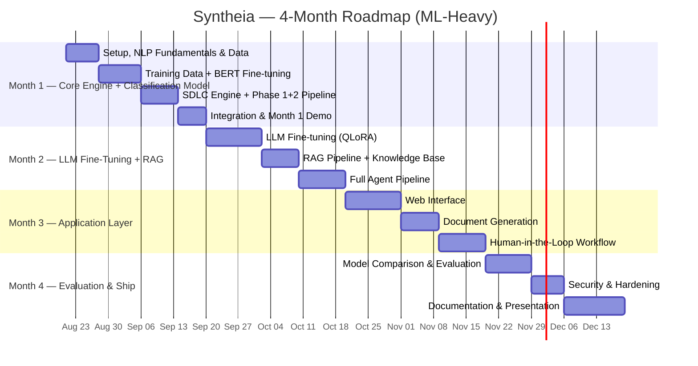
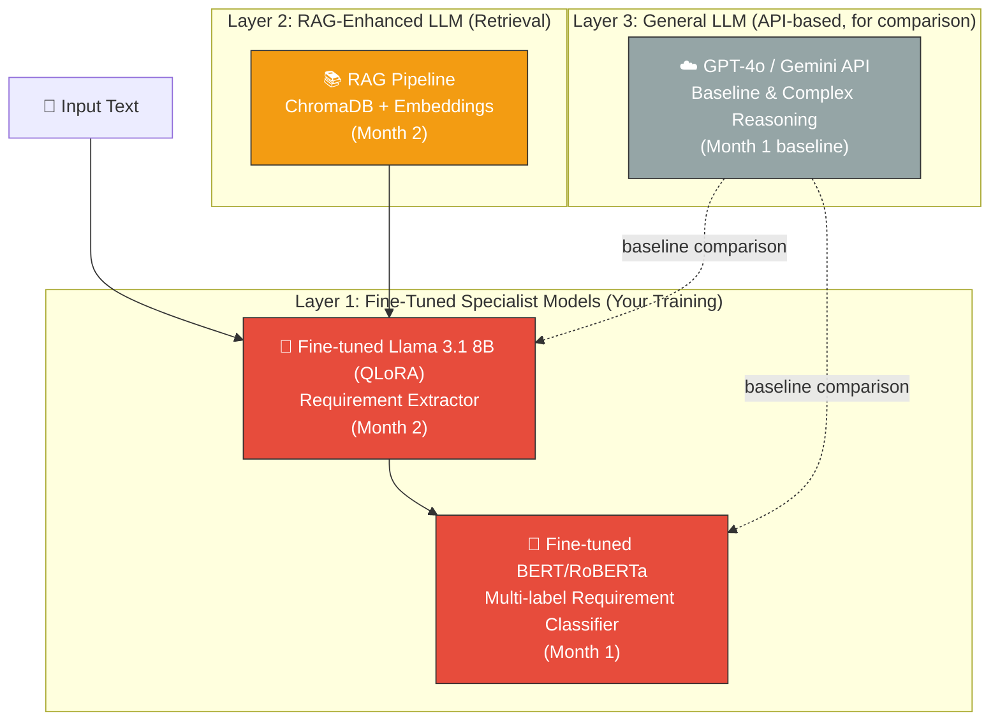
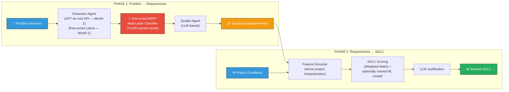
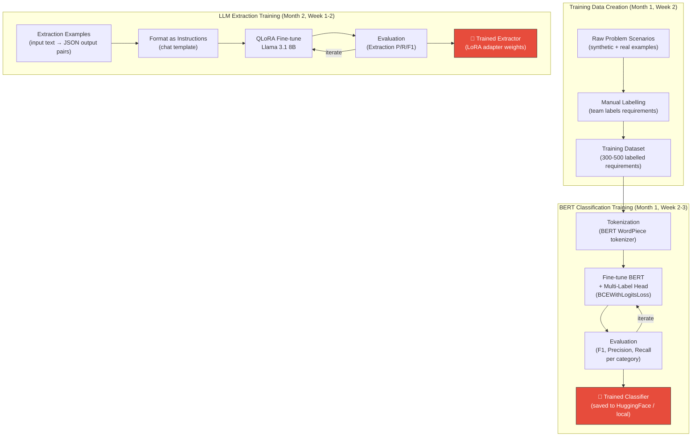
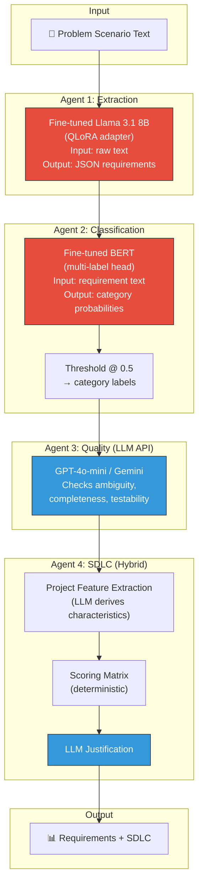
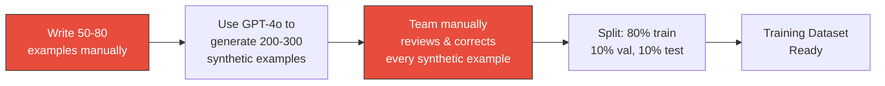

# Syntheia — 4-Month Implementation Plan (v2 — With Fine-Tuning)
## Agentic AI for Automated Requirement Gathering, Analysis & SDLC Identification in Financial Services

---

## Project Timeline Overview



### Month-End Deliverables

| Month | Deliverable | ML Component |
|-------|------------|--------------|
| **Month 1** | **Phase 1:** Problem scenario → structured requirements. **Phase 2:** Requirements + conditions → SDLC recommendation. | Fine-tuned BERT/RoBERTa for multi-label requirement classification. Zero-shot LLM baseline for comparison. |
| **Month 2** | RAG-grounded agents, compliance mapping, full multi-agent pipeline. | Fine-tuned Llama 3.1 8B / Mistral 7B (QLoRA) for requirement extraction. RAG pipeline with embeddings. |
| **Month 3** | Web application (chat UI, dashboard, approval workflow), document generation. | Models deployed via inference pipeline. Streamlit serving fine-tuned models. |
| **Month 4** | Full evaluation, security, documentation, presentation. | Comprehensive comparison: fine-tuned models vs. API-based (GPT-4o) vs. zero-shot baselines. |

---

## 1. Project Understanding

*(Same problem statement and objectives as before — see the problem statement document)*

### What Changes With Fine-Tuning

The architecture now has **three model layers**:



| Component | Approach | Why Fine-Tune Instead of API? |
|-----------|----------|-------------------------------|
| **Requirement Classification** | Fine-tuned BERT/RoBERTa (Month 1) | Classic NLP classification task. A fine-tuned 110M param model will be faster, cheaper, offline-capable, and competitive with GPT-4o for this specific task. Shows real ML skills. |
| **Requirement Extraction** | Fine-tuned Llama 3.1 8B with QLoRA (Month 2) | Domain-specific structured extraction benefits hugely from fine-tuning. The model learns your exact output format, financial terminology, and extraction patterns. |
| **Quality Analysis** | LLM-based (API or fine-tuned) | Requires complex reasoning — harder to fine-tune, better suited for larger models. Use API for MVP, optionally fine-tune later. |
| **SDLC Recommendation** | Hybrid: ML classifier + LLM justification | The scoring can be a trained model (Random Forest / XGBoost on project features). The justification uses LLM. |
| **Interview / Compliance / Docs** | LLM API (GPT-4o / Gemini) | These need broad knowledge and conversational ability — fine-tuning a small model won't match a large API model here. |

---

## 2. Technical & ML Breakdown

### Concepts Required — Updated With Fine-Tuning

| Concept | Month | Why We Need It | Depth | Prerequisites |
|---------|-------|---------------|-------|---------------|
| **Python for ML** | 1 | Everything runs on Python | Have it already | — |
| **NLP Fundamentals** | 1 | Understand tokenization, embeddings, attention — the foundation for everything | Medium — conceptual understanding, not math-heavy | Basic linear algebra concepts |
| **Transformers Architecture** | 1 | Understand how BERT/Llama work internally — you're fine-tuning them | Medium — understand encoder vs decoder, attention mechanism, what layers do | NLP fundamentals |
| **Hugging Face Ecosystem** | 1 | `transformers`, `datasets`, `tokenizers`, `Trainer` — your primary ML framework | Deep — you'll use this daily | Python, basic PyTorch |
| **Transfer Learning & Fine-Tuning** | 1 | Core technique: take a pre-trained model, adapt it to your task | Deep — understand what layers to freeze, learning rates, overfitting | Transformers basics |
| **Multi-Label Classification** | 1 | Requirement classification into 13 categories (one requirement can have multiple labels) | Deep — sigmoid vs softmax, thresholding, BCELoss, F1 metrics | Basic classification concepts |
| **LoRA / QLoRA** | 2 | Fine-tune a 8B parameter LLM on a single GPU by only training small adapter layers | Deep — understand rank, alpha, target modules | Transformers, fine-tuning concepts |
| **PEFT (Parameter-Efficient Fine-Tuning)** | 2 | Hugging Face library for LoRA/QLoRA — practical implementation | Deep — this is how you actually fine-tune Llama | Hugging Face basics |
| **Instruction Tuning / SFT** | 2 | Train the LLM to follow your specific extraction instructions | Medium — data formatting, chat templates | LoRA, Hugging Face |
| **Structured Output from LLMs** | 1–2 | Get JSON/Pydantic objects from both API and fine-tuned models | Deep | Prompt engineering |
| **RAG (Retrieval-Augmented Generation)** | 2 | Ground model responses in actual regulations | Deep | Vector DBs, embeddings |
| **Text Embeddings & Vector Search** | 2 | Searchable knowledge base | Medium | Linear algebra (conceptual) |
| **LangGraph / Agent Orchestration** | 1–2 | Coordinate multiple models and agents | Deep | LLM basics |
| **Model Evaluation & Experiment Tracking** | 1–4 | Compare models properly: precision, recall, F1, confusion matrices | Deep | Basic statistics |
| **Web Development (Streamlit)** | 3 | Serve models via web interface | Medium | HTML/CSS basics |
| **Basic PyTorch** | 1 | Understand tensors, dataloaders, training loops (even though Hugging Face abstracts most of it) | Light-Medium — enough to debug issues | Python, numpy |

### What You Now Need to Learn (vs. Previous Plan)

The previous plan needed zero ML knowledge. Now you need:

| New Skill | Why | How Long to Learn |
|-----------|-----|------------------|
| How transformers work (conceptually) | You're fine-tuning them — need to understand what you're doing | 2–3 days |
| Hugging Face `transformers` library | Load models, tokenize data, train, evaluate | 2–3 days |
| Multi-label classification with BERT | Month 1's primary ML deliverable | 3–4 days |
| LoRA/QLoRA with `peft` | Month 2's primary ML deliverable | 2–3 days |
| Training data creation | You need labelled datasets — this is non-trivial | Ongoing |
| Experiment tracking (W&B or MLflow) | Track all your training runs properly | 1 day |

---

## 3. Technology & Tools — Updated

### ML / Fine-Tuning Stack

| Layer | Technology | Why |
|-------|-----------|-----|
| **Classification Model** | `bert-base-uncased` or `roberta-base` (110M params) | Small enough to fine-tune on Colab free tier. Excellent for text classification. |
| **Extraction LLM (fine-tuned)** | `meta-llama/Llama-3.1-8B-Instruct` or `mistralai/Mistral-7B-Instruct-v0.3` | Best open-source models at 7-8B scale. QLoRA makes them trainable on a single T4/P100. |
| **Fine-tuning method** | QLoRA (4-bit quantization + LoRA adapters) via `peft` | Reduces GPU memory from 32GB → 6-8GB. Trainable on free GPU. |
| **Training framework** | Hugging Face `transformers` + `peft` + `trl` (SFTTrainer) | Industry standard. Best documentation. Handles all the complexity. |
| **Tokenizer** | Model-specific (AutoTokenizer from Hugging Face) | Must match the model |
| **Dataset handling** | Hugging Face `datasets` library | Efficient data loading, preprocessing, train/val/test splits |
| **Compute (free)** | **Google Colab** (free T4 16GB) or **Kaggle** (free P100 16GB) | Sufficient for QLoRA fine-tuning of 7-8B models |
| **Experiment tracking** | **Weights & Biases** (free tier) or **MLflow** | Track training loss, eval metrics, hyperparameters across runs |
| **Quantization** | `bitsandbytes` | 4-bit quantization for QLoRA |
| **Inference** | `transformers` pipeline or `vllm` (if speed needed) | Serve fine-tuned models |

### Full Stack (Updated)

| Layer | Technology | Month |
|-------|-----------|-------|
| **Classification Model** | Fine-tuned BERT/RoBERTa | 1 |
| **Extraction LLM** | Fine-tuned Llama 3.1 8B (QLoRA) | 2 |
| **Baseline LLM (comparison)** | OpenAI GPT-4o-mini / Gemini API | 1 |
| **Agent Framework** | LangGraph (LangChain) | 1–2 |
| **Vector Database** | ChromaDB | 2 |
| **Embeddings** | `all-MiniLM-L6-v2` (sentence-transformers) | 2 |
| **Backend** | FastAPI | 3 |
| **Frontend** | Streamlit → Next.js | 3 |
| **Experiment Tracking** | Weights & Biases | 1–4 |
| **Document Generation** | Jinja2 + python-docx | 3 |
| **Version Control** | Git + GitHub | 1 |

### Why These Specific Models?

**Why BERT/RoBERTa for classification (not fine-tuned Llama)?**
- Classification is a well-solved problem — BERT-sized models (110M params) perform excellently
- 1000x faster inference than an 8B model
- Fine-tunes in minutes on Colab (vs. hours for Llama)
- Shows you understand that **bigger isn't always better** — right model for the right task
- Multi-label classification with a custom head is a core ML skill professors expect

**Why Llama 3.1 8B over Mistral 7B?**
- Llama 3.1 has better instruction following
- Larger context window (128K tokens)
- Better at structured output (JSON generation)
- More active community and more fine-tuning examples available
- Either works — pick whichever has better tutorials available

**Why QLoRA over full fine-tuning?**
- Full fine-tuning of 8B params needs 60GB+ GPU memory — impossible on free compute
- QLoRA trains only ~0.1% of parameters (LoRA adapters) in 4-bit precision
- Needs only 6-8GB GPU memory → fits on free Colab T4
- Quality is 95%+ of full fine-tuning for most tasks

---

## 4. ML / System Architecture — Updated

### Month 1 Architecture (With Fine-Tuned Classification)



### Model Training Pipeline



### How Fine-Tuned Models Fit Into the Agent Pipeline



---

## 5. Dataset & Model Strategy — Updated

### Training Data You Need to Create

> [!IMPORTANT]
> **Training data creation is the hardest part of fine-tuning.** You don't have a pre-existing dataset of financial requirements — you need to create it. Budget 3–4 days for this in Month 1.

#### Dataset 1: Requirement Classification (For BERT)

| Field | Detail |
|-------|--------|
| **What** | Labelled requirements with multi-label categories |
| **Format** | `{"text": "The system shall encrypt all data at rest", "labels": ["Security", "Data-management"]}` |
| **Size needed** | 300–500 labelled examples (minimum 20–30 per category) |
| **How to create** | (1) Write 50–80 manually, (2) Use GPT-4o to generate 200+ synthetic examples with labels, (3) Manually verify and correct the synthetic ones, (4) Split 80/10/10 train/val/test |
| **Categories** | Business, Stakeholder, Functional, Security, Privacy, Regulatory, Performance, Availability, Usability, Data-management, Integration, Audit/Reporting, Operational |

**Example training samples:**

```json
{"text": "The system shall process loan applications within 30 seconds", "labels": ["Performance", "Functional"]}
{"text": "All PII must be encrypted using AES-256 at rest and TLS 1.3 in transit", "labels": ["Security", "Privacy", "Data-management"]}
{"text": "Monthly compliance reports must be generated for RBI submission", "labels": ["Regulatory", "Audit/Reporting", "Functional"]}
{"text": "The system must integrate with the existing core banking API via REST", "labels": ["Integration", "Functional"]}
{"text": "System uptime must be 99.99% during banking hours", "labels": ["Availability", "Performance"]}
```

#### Dataset 2: Requirement Extraction (For Llama fine-tuning)

| Field | Detail |
|-------|--------|
| **What** | Input-output pairs: raw text → structured JSON requirements |
| **Format** | Instruction format: `{"instruction": "Extract requirements from: ...", "output": "[{id, statement, priority, ...}]"}` |
| **Size needed** | 150–300 examples |
| **How to create** | (1) Write 30–50 problem scenarios of varying complexity, (2) Manually extract requirements for each, (3) Use GPT-4o to generate additional examples, (4) Manually verify |

**Example training sample:**

```json
{
  "instruction": "Extract all software requirements from the following text:\n\nWe need an online loan application portal where customers can apply from their mobile phones. The application must verify identity through Aadhaar-based eKYC. Credit scores should be fetched from CIBIL in real-time. Applications above 50 lakhs need manual approval from a senior officer. All data must comply with RBI's digital lending guidelines.",
  "output": [
    {"id": "REQ-001", "statement": "The system shall provide a mobile-responsive online loan application portal", "priority": "High", "category_hint": "Functional, Usability"},
    {"id": "REQ-002", "statement": "The system shall verify applicant identity through Aadhaar-based eKYC", "priority": "High", "category_hint": "Functional, Regulatory, Security"},
    {"id": "REQ-003", "statement": "The system shall fetch credit scores from CIBIL in real-time during application processing", "priority": "High", "category_hint": "Functional, Integration"},
    {"id": "REQ-004", "statement": "Loan applications exceeding INR 50 lakhs shall require manual approval from a senior officer", "priority": "Medium", "category_hint": "Business, Functional"},
    {"id": "REQ-005", "statement": "All data handling shall comply with RBI digital lending guidelines", "priority": "High", "category_hint": "Regulatory, Data-management"}
  ]
}
```

#### Dataset 3: SDLC Recommendation (Optional — for ML classifier)

| Field | Detail |
|-------|--------|
| **What** | Project characteristics → SDLC model mapping |
| **Format** | Tabular: 13 features → SDLC label |
| **Size needed** | 100–200 examples (can be synthetic) |
| **How to create** | Generate synthetic project profiles with known correct SDLC mappings. Use the problem statement's table as seed rules. |

### Data Creation Strategy (Practical)



> [!WARNING]
> **Do NOT skip manual verification of synthetic data.** GPT-4o will generate plausible-looking but sometimes wrong labels. Every example must be reviewed by a human. This is tedious but critical — garbage data = garbage model.

### Model Comparison Plan

| Model | Type | Month Built | Purpose |
|-------|------|-------------|---------|
| **Zero-shot GPT-4o-mini** | API baseline | Month 1 | Baseline — how good is a generic LLM with just a prompt? |
| **Few-shot GPT-4o** | API + examples | Month 1 | Stronger baseline — does adding examples to the prompt help? |
| **Fine-tuned BERT** | Your trained model | Month 1 | Classification specialist — trained specifically on your categories |
| **Fine-tuned Llama 3.1 8B** | Your trained model | Month 2 | Extraction specialist — trained on your specific task |
| **Fine-tuned + RAG** | Your model + retrieval | Month 2 | Best version — domain-specific model grounded in real documents |

This gives you a **progression of experiments** to show the professor:
1. Zero-shot → baseline performance
2. Few-shot → does context help?
3. Fine-tuned BERT → does task-specific training beat prompting?
4. Fine-tuned Llama → does a fine-tuned LLM beat API-based extraction?
5. Fine-tuned + RAG → does retrieval improve fine-tuned model?

---

## 6. Learning Resources — Updated With NLP & Fine-Tuning

### 🧠 NLP & Transformers Fundamentals (Study in Week 1)

| Resource | What to Study | Time | Priority |
|----------|--------------|------|----------|
| [**3Blue1Brown: But what is a GPT? (YouTube)**](https://www.youtube.com/watch?v=wjZofJX0v4M) | Visual intuition for how transformers work: tokens, embeddings, attention, layers. **Watch first — builds intuition before diving into code.** | 45 min | 🔴 Must |
| [**Hugging Face NLP Course — Chapter 1-3**](https://huggingface.co/learn/nlp-course/chapter1/1) | Ch1: What are transformers, pipeline API. Ch2: How tokenizers work. Ch3: Fine-tuning a pre-trained model with `Trainer`. **This is your primary learning resource. Follow the code.** | 4–5 hours | 🔴 Must |
| [**Jay Alammar: The Illustrated Transformer**](https://jalammar.github.io/illustrated-transformer/) | Visual explanation of the transformer architecture: self-attention, multi-head attention, positional encoding. **Read for understanding, not memorisation.** | 1.5 hours | 🔴 Must |
| [**Jay Alammar: The Illustrated BERT**](https://jalammar.github.io/illustrated-bert/) | How BERT is pre-trained (MLM + NSP), how to fine-tune it for classification. **Directly relevant to your Month 1 task.** | 1 hour | 🟡 Should |

### 🔧 Hugging Face `transformers` Library (Study in Week 1–2)

| Resource | What to Study | Time | Priority |
|----------|--------------|------|----------|
| [**Hugging Face Fine-tuning Tutorial**](https://huggingface.co/docs/transformers/training) | Using `Trainer`, `TrainingArguments`, custom datasets, evaluation. **Your primary fine-tuning reference.** | 2 hours | 🔴 Must |
| [**Hugging Face: Multi-label Classification**](https://huggingface.co/docs/transformers/tasks/sequence_classification#multi-label-classification) | Specifically how to set up multi-label classification with `problem_type="multi_label_classification"`. | 1 hour | 🔴 Must |
| [**Hugging Face `datasets` library**](https://huggingface.co/docs/datasets/loading) | Loading custom data, creating Dataset objects, preprocessing, train/test splits | 1 hour | 🔴 Must |

### 🔄 LoRA / QLoRA Fine-Tuning (Study in Month 2, Week 1)

| Resource | What to Study | Time | Priority |
|----------|--------------|------|----------|
| [**Hugging Face PEFT Documentation**](https://huggingface.co/docs/peft/quicktour) | What is PEFT, LoRA configuration, loading/saving adapters. **Quick start is sufficient.** | 1.5 hours | 🔴 Must |
| [**YouTube: Fine-tune Llama 3 with QLoRA (Trelis Research)**](https://www.youtube.com/results?search_query=fine+tune+llama+3+qlora+tutorial) | Practical video walkthrough of QLoRA fine-tuning. Search for the most recent tutorial. **Follow along in Colab.** | 2 hours | 🔴 Must |
| [**Hugging Face `trl` SFTTrainer**](https://huggingface.co/docs/trl/sft_trainer) | Supervised Fine-Tuning trainer — the easiest way to fine-tune an instruction-following LLM. **This is what you'll actually use.** | 1.5 hours | 🔴 Must |
| [**Original LoRA Paper (Hu et al., 2021)**](https://arxiv.org/abs/2106.09685) | Read sections 1–3 only: motivation, how LoRA works, why it's efficient. Skip the math if needed. **Good for your report and presentation.** | 30 min | 🟡 Should |
| [**QLoRA Paper (Dettmers et al., 2023)**](https://arxiv.org/abs/2305.14314) | Read the abstract and Section 1-2: what QLoRA adds over LoRA (4-bit quantization). **For your report.** | 20 min | 🟢 Optional |

### 📊 Model Evaluation (Study in Month 1, Week 3)

| Resource | What to Study | Time | Priority |
|----------|--------------|------|----------|
| [**Scikit-learn: Multi-label Classification Metrics**](https://scikit-learn.org/stable/modules/model_evaluation.html#multilabel-ranking-metrics) | Hamming loss, micro/macro F1, per-label metrics. **Understand which metric to report.** | 1 hour | 🔴 Must |
| [**Weights & Biases Quick Start**](https://docs.wandb.ai/quickstart) | Set up W&B for experiment tracking. Log training loss, eval metrics, model configs. | 30 min | 🟡 Should |

### 🔗 LangGraph & Agent Orchestration (Same as before)

| Resource | What to Study | Time | Priority |
|----------|--------------|------|----------|
| [**LangGraph Quick Start**](https://langchain-ai.github.io/langgraph/tutorials/introduction/) | StateGraph, nodes, edges, conditional routing. | 4 hours | 🔴 Must |
| [**LangGraph Multi-Agent**](https://langchain-ai.github.io/langgraph/tutorials/multi_agent/multi-agent-collaboration/) | Agent handoffs, supervisor pattern. | 2 hours | 🟡 Month 2 |

### 📚 RAG (Month 2)

| Resource | What to Study | Time | Priority |
|----------|--------------|------|----------|
| [**LangChain RAG Tutorial**](https://python.langchain.com/docs/tutorials/rag/) | Full RAG pipeline | 3 hours | 🔴 Must (Month 2) |
| [**ChromaDB Getting Started**](https://docs.trychroma.com/getting-started) | Collections, queries, metadata | 1 hour | 🔴 Must (Month 2) |

### 📝 Requirement Engineering (Domain Knowledge)

| Resource | What to Study | Time | Priority |
|----------|--------------|------|----------|
| [**IEEE 830 SRS summary**](https://www.google.com/search?q=IEEE+830+SRS+template+summary) | SRS document structure | 1 hour | 🔴 Must |
| [**SDLC Models (GeeksforGeeks)**](https://www.geeksforgeeks.org/software-development-life-cycle-sdlc/) | When to use each SDLC model | 1 hour | 🔴 Must |

### 📋 Total Learning Time (Month 1)

| Topic | Hours |
|-------|-------|
| Transformers & NLP fundamentals | ~7 hours |
| Hugging Face library + fine-tuning | ~4 hours |
| Multi-label classification specific | ~2 hours |
| LangGraph | ~4 hours |
| Domain knowledge (requirements, SDLC) | ~2 hours |
| Experiment tracking (W&B) | ~0.5 hours |
| **Total** | **~19.5 hours** |

Split across 4–5 days of learning = **4 hours/day of theory**. Very doable.

---

## 7. Implementation Plan

---

# 🔵 MONTH 1 — Core Engine + Fine-Tuned Classifier (Day-by-Day)

**Goal:** Two working phases with a **fine-tuned BERT classifier** as the ML centerpiece:
1. Problem Scenario → Structured, Classified (by your trained model), Quality-Checked Requirements
2. Requirements + Conditions → Ranked SDLC Recommendation

---

## Week 1: Setup, NLP Fundamentals & Baselines (Days 1–7)

### Day 1: Project Setup + NLP Theory Kickoff

| Item | Detail |
|------|--------|
| **Theory** | Watch 3Blue1Brown "But what is a GPT?" (45 min). Read "The Illustrated Transformer" by Jay Alammar (1.5 hours). Understand: tokens, embeddings, self-attention, encoder vs decoder. |
| **Implementation** | Set up GitHub repo with project structure. Create Python virtual environment. Install: `transformers`, `datasets`, `peft`, `torch`, `openai`, `langchain`, `langgraph`, `pydantic`, `scikit-learn`, `wandb`. Set up `.env` with API keys. Set up Weights & Biases account (free). |
| **Deliverable** | GitHub repo with structure + all dependencies installed. Team understands how transformers work conceptually. |
| **Definition of Done** | `python -c "import transformers, torch, langgraph; print('ready')"` works. Everyone can explain attention mechanism in their own words. |

### Day 2: Hugging Face Fundamentals + BERT Understanding

| Item | Detail |
|------|--------|
| **Theory** | Complete Hugging Face NLP Course Chapter 1 (Transformer models, pipeline API) and Chapter 2 (Using tokenizers). Read "The Illustrated BERT" by Jay Alammar. Understand: how BERT is pre-trained, what fine-tuning means, encoder-only vs decoder-only. |
| **Implementation** | Write a notebook `notebooks/01_hf_basics.ipynb`: load `bert-base-uncased`, tokenize sample requirement texts, get embeddings, do simple similarity comparison between requirements. Use the `pipeline` API for zero-shot classification — try classifying 10 sample requirements into your 13 categories. |
| **Deliverable** | Working notebook demonstrating BERT tokenization, embeddings, and zero-shot classification |
| **Definition of Done** | Can explain the difference between BERT (encoder) and Llama (decoder). Zero-shot classification works but accuracy is mediocre (this sets up the motivation for fine-tuning). |

### Day 3: LangGraph Basics + LLM API Integration

| Item | Detail |
|------|--------|
| **Theory** | Complete LangGraph Quick Start tutorial. Understand StateGraph, nodes, edges. Study OpenAI structured output docs. |
| **Implementation** | Build `src/utils/llm.py` — wrapper around OpenAI/Gemini API. Build a minimal 2-node LangGraph: Node 1 = Extraction (GPT-4o-mini extracts requirements from text → JSON). Node 2 = placeholder for classification. Define `Requirement` Pydantic model in `src/models/requirement.py`. Test: paragraph in → structured requirements out. |
| **Deliverable** | Working LLM API integration + LangGraph skeleton |
| **Definition of Done** | Can send a problem scenario to GPT-4o-mini and get back structured `Requirement` objects via LangGraph. |

### Day 4: Extraction Agent (API-Based Baseline)

| Item | Detail |
|------|--------|
| **Theory** | Study OpenAI Prompt Engineering Guide (2 hours). Understand system messages, few-shot prompting, chain-of-thought. |
| **Implementation** | Build `src/agents/extraction.py` — LLM-based extraction agent. Design the extraction prompt with: system message (you are a requirements engineer), few-shot examples (3–5 gold extraction examples), structured output spec (Pydantic). Handle: compound requirements (split them), implicit requirements (make them explicit), edge cases (no requirements in text). **This is the API baseline** — you'll compare the fine-tuned Llama against this in Month 2. |
| **Deliverable** | Extraction agent that pulls 5+ structured requirements from a paragraph |
| **Definition of Done** | Given a loan-processing scenario, extracts at least 5 distinct requirements with ID, statement, priority. Log the API baseline metrics. |

### Day 5: Classification — Zero-Shot + Few-Shot Baselines

| Item | Detail |
|------|--------|
| **Theory** | Hugging Face NLP Course Chapter 3 (Fine-tuning a pre-trained model). Read the multi-label classification docs. Understand `problem_type="multi_label_classification"`, BCEWithLogitsLoss, sigmoid thresholding. |
| **Implementation** | Build **two baselines** for classification (these are what you compare your fine-tuned BERT against): (1) **Zero-shot baseline**: Use GPT-4o-mini to classify requirements into 13 categories with just a prompt. Record accuracy. (2) **Few-shot baseline**: Same but with 2–3 examples per category in the prompt. Record accuracy. Save both sets of predictions for later comparison. |
| **Deliverable** | Two baseline classification approaches with documented metrics |
| **Definition of Done** | Have zero-shot F1 score and few-shot F1 score recorded on at least 20 manually labelled requirements. These are your baselines to beat. |

### Day 6: Quality Agent + LangGraph Pipeline

| Item | Detail |
|------|--------|
| **Theory** | Study requirement quality attributes: ambiguity, completeness, testability. |
| **Implementation** | Build `src/agents/quality.py` — LLM-based quality checker. Design prompt to check for: ambiguous terms, missing scope, untestable statements, undefined terminology. Wire Extraction → (placeholder Classification) → Quality into a 3-node LangGraph. Test on sample requirements. |
| **Deliverable** | Quality agent + integrated pipeline skeleton |
| **Definition of Done** | Pipeline runs: text → extraction → quality check → output with flags. Correctly flags planted ambiguous requirements. |

### Day 7: Training Data Creation — Phase 1

| Item | Detail |
|------|--------|
| **Theory** | Study the loan origination process. Understand perspectives of different stakeholders (business, security, compliance, tech). |
| **Implementation** | **This is a critical day. Creating training data is the foundation of your fine-tuning.** (1) Write 50–80 requirements manually with correct multi-label categories. Cover all 13 categories with at least 5 examples each. (2) Use GPT-4o to generate 150+ additional synthetic examples: prompt it with "Generate 20 financial software requirements that fall under [category] and [category]". (3) Begin manual review of synthetic examples. Create the "QuickLoan Digital" test scenario. |
| **Deliverable** | ~200 labelled requirements (draft — review continues Day 8) + test scenario |
| **Definition of Done** | Spreadsheet/JSON with 200+ labelled requirements. Every category has 15+ examples. **Week 1 review with team.** |

---

## Week 2: BERT Fine-Tuning & Training (Days 8–14)

### Day 8: Training Data — Finalisation & Quality Check

| Item | Detail |
|------|--------|
| **Theory** | None — data work day. |
| **Implementation** | Continue manual review of all synthetic training examples. Fix wrong labels. Remove poor examples. Add diversity: different financial domains (banking, insurance, payments, KYC). Target: 300–500 high-quality labelled examples. Split: 80% train / 10% val / 10% test. Create the Hugging Face `Dataset` object. Save to `data/training/classification/`. |
| **Deliverable** | Final, reviewed training dataset for classification |
| **Definition of Done** | 300+ examples, all manually verified, all 13 categories covered (20+ each), train/val/test split saved. |

### Day 9: BERT Fine-Tuning — Setup & First Run

| Item | Detail |
|------|--------|
| **Theory** | Re-read Hugging Face multi-label classification tutorial. Understand `TrainingArguments` hyperparameters. |
| **Implementation** | Create `notebooks/02_bert_finetuning.ipynb` (run on Colab/Kaggle). Steps: (1) Load `bert-base-uncased` with `AutoModelForSequenceClassification(num_labels=13, problem_type="multi_label_classification")`. (2) Tokenize dataset. (3) Set up `Trainer` with `TrainingArguments` (lr=2e-5, epochs=5, batch_size=16). (4) Define evaluation metrics (multi-label F1, per-category precision/recall). (5) Train. (6) Evaluate on val set. Log everything to W&B. |
| **Deliverable** | First fine-tuned BERT model with evaluation metrics |
| **Definition of Done** | Model trains without errors. Val F1 > 50% (first run, will improve). Training loss decreases. Results logged to W&B. |

### Day 10: BERT Fine-Tuning — Iteration & Hyperparameter Tuning

| Item | Detail |
|------|--------|
| **Theory** | Understand learning rate scheduling, weight decay, early stopping. |
| **Implementation** | Iterate on the model: (1) Try different learning rates (1e-5, 2e-5, 5e-5). (2) Try different epochs (3, 5, 10). (3) Try `roberta-base` as an alternative base model. (4) Analyse per-category performance — which categories are hardest? Add more training examples for weak categories. (5) Try weighted loss for imbalanced categories. Track all experiments in W&B. |
| **Deliverable** | Best BERT/RoBERTa model with optimised hyperparameters |
| **Definition of Done** | Val F1 > 65%. Per-category analysis done. Best model identified and saved. W&B has 5+ experiment runs logged. |

### Day 11: BERT Model — Integration Into Pipeline

| Item | Detail |
|------|--------|
| **Theory** | Hugging Face inference pipeline, model loading/saving. |
| **Implementation** | Build `src/agents/classification.py` — **now using your fine-tuned BERT**, not API calls. Steps: (1) Save the best model to `models/bert_classifier/`. (2) Create a classification agent that loads the model and runs inference. (3) Apply sigmoid + threshold (0.5) to get binary labels per category. (4) Replace the placeholder classification node in the LangGraph pipeline. (5) Compare: fine-tuned BERT vs. zero-shot baseline vs. few-shot baseline on the test set. |
| **Deliverable** | Classification agent powered by YOUR fine-tuned model, integrated into the pipeline |
| **Definition of Done** | Pipeline uses fine-tuned BERT for classification. Comparison table: zero-shot F1 vs. few-shot F1 vs. fine-tuned F1. Fine-tuned should win. |

### Day 12: SDLC Recommendation Engine — Design & Scoring Matrix

| Item | Detail |
|------|--------|
| **Theory** | Deep-dive into SDLC models: Waterfall, V-Model, Agile, Spiral, DevSecOps, hybrids. Study when each is appropriate. Study the problem statement's SDLC selection factors. |
| **Implementation** | Build `src/agents/sdlc.py` and `src/models/sdlc.py`: (1) Define 13 project characteristics as inputs. (2) Define 6 SDLC options + hybrids. (3) Create weighted scoring matrix. (4) Build the project characteristic extractor — LLM analyses requirements and infers characteristics. (5) Build the justification generator — LLM explains the recommendation. |
| **Deliverable** | Complete SDLC engine: requirements + conditions → ranked recommendations |
| **Definition of Done** | For loan-processing (high regulation + evolving requirements): recommends Agile-DevSecOps hybrid. Justification references actual characteristics. |

### Day 13: SDLC Engine — Manual Input + Auto-Derivation

| Item | Detail |
|------|--------|
| **Theory** | None — implementation day. |
| **Implementation** | (1) Add manual project conditions input (JSON). (2) Implement merge logic: manual overrides auto-derived. (3) Test with different condition sets on same requirements. (4) Add SDLC workflow outline generation (phases, activities, roles). (5) Create CLI: `python main.py --phase 2 --requirements reqs.json --conditions conds.json`. |
| **Deliverable** | SDLC engine with both auto and manual inputs |
| **Definition of Done** | Different conditions produce different rankings. "Stable + formal" → Waterfall. "Evolving + regulated" → Agile-DevSecOps. |

### Day 14: Phase 1 + Phase 2 End-to-End Integration

| Item | Detail |
|------|--------|
| **Theory** | None — integration day. |
| **Implementation** | Wire everything into a single pipeline: text input → Extraction (API) → Classification (fine-tuned BERT) → Quality Check (API) → SDLC Recommendation (hybrid). Test end-to-end on loan-processing scenario. Create 2nd test scenario (payment system). Measure all metrics. |
| **Deliverable** | Complete Phase 1 + Phase 2 pipeline working end-to-end |
| **Definition of Done** | Single command runs entire pipeline. Works on 2 scenarios. Classification uses YOUR model. **Week 2 review. Show the comparison table: your fine-tuned model vs baselines.** |

---

## Week 3: SDLC Refinement & Second Scenario (Days 15–21)

### Day 15: Model Error Analysis & Data Augmentation

| Item | Detail |
|------|--------|
| **Theory** | Understand confusion matrices for multi-label classification. |
| **Implementation** | Deep error analysis of BERT classifier: which categories confuse each other? Plot per-category precision/recall. Generate confusion matrix. If specific categories underperform: add 20–30 more training examples for those categories. Retrain and compare. |
| **Deliverable** | Error analysis report + improved model if applicable |
| **Definition of Done** | Understand exactly where the model fails. Either improved the model or documented why it's at its limit. |

### Day 16–17: SDLC Engine Refinement

| Item | Detail |
|------|--------|
| **Theory** | Study hybrid SDLC models. Multi-criteria decision analysis. |
| **Implementation** | Refine scoring weights. Add hybrid model scoring. Add confidence to recommendations. Implement basic SDLC workflow generation (phases, activities, roles, deliverables). Test on 3+ scenarios with different conditions. |
| **Deliverable** | Polished SDLC engine with hybrids, confidence, and workflow |
| **Definition of Done** | Produces sensible recommendations with confidence scores on all test scenarios. |

### Day 18–19: Second & Third Test Scenarios

| Item | Detail |
|------|--------|
| **Theory** | Study payment system requirements, KYC/onboarding requirements. |
| **Implementation** | Create payment system scenario + KYC scenario. Run full pipeline on both. Compare extraction quality, classification accuracy, SDLC recommendations across scenarios. Identify domain-specific issues. |
| **Deliverable** | Pipeline tested on 3 different financial domains |
| **Definition of Done** | System generalises across domains without scenario-specific hardcoding. |

### Day 20: Output Formatting & Comparison Report

| Item | Detail |
|------|--------|
| **Theory** | None. |
| **Implementation** | Create clean output formatting: requirements table, SDLC report, quality flags. Build a comprehensive **model comparison notebook** (`notebooks/03_model_comparison.ipynb`) showing: zero-shot vs few-shot vs fine-tuned BERT performance, per-category breakdown, example predictions, training curves from W&B. |
| **Deliverable** | Polished comparison report showing the value of fine-tuning |
| **Definition of Done** | Clear evidence that fine-tuned BERT outperforms API baselines for classification. |

### Day 21: Week 3 Metrics & Review

| Item | Detail |
|------|--------|
| **Theory** | None. |
| **Implementation** | Calculate all Month 1 final metrics. Document results. Identify weakest component. |
| **Deliverable** | Month 1 evaluation report |
| **Definition of Done** | Extraction P/R documented, Classification F1 (all 3 approaches) documented, SDLC accuracy on 3+ scenarios documented. **Week 3 review.** |

---

## Week 4: Hardening & Month 1 Delivery (Days 22–30)

### Day 22–23: Weakest Link Improvement

| Item | Detail |
|------|--------|
| **Theory** | Based on metrics, study the weak area. |
| **Implementation** | 2 days improving the weakest component. Options: more training data + retrain BERT, better extraction prompts, refined SDLC weights. Iterate and measure. |
| **Deliverable** | Measurable improvement in weakest metric |
| **Definition of Done** | Weakest metric improves by 10+ percentage points. |

### Day 24: Edge Cases & Robustness

| Item | Detail |
|------|--------|
| **Theory** | None. |
| **Implementation** | Test edge cases: short input, long input, non-financial input, contradictory requirements, ambiguous domain. |
| **Deliverable** | Edge case test report |
| **Definition of Done** | System doesn't crash. Handles all edge cases. |

### Day 25–26: Code Cleanup & Prompt Library

| Item | Detail |
|------|--------|
| **Theory** | None. |
| **Implementation** | Clean code: consistent naming, docstrings, type hints. Externalise prompts to `src/utils/prompts.py`. Create config file for model paths, hyperparameters, scoring weights. Ensure Phase 1 and Phase 2 are independently runnable. Save trained BERT model to `models/` with a `model_card.md`. |
| **Deliverable** | Clean, modular codebase with externalised config |
| **Definition of Done** | Any team member can run both phases. Model can be loaded from saved checkpoint. |

### Day 27–28: Month 1 Demo Notebook + Preparation

| Item | Detail |
|------|--------|
| **Theory** | None. |
| **Implementation** | Create a polished demo notebook (`notebooks/04_month1_demo.ipynb`): (1) Show input scenario, (2) Run Phase 1 with YOUR fine-tuned model, (3) Show requirements table, (4) Show model comparison chart (fine-tuned vs baselines), (5) Show SDLC recommendation. Create training curves visualisation from W&B. Record backup demo video. |
| **Deliverable** | Demo notebook + backup video |
| **Definition of Done** | Demo runs in under 5 minutes. Includes ML experiments (training curves, comparison). Impressive. |

### Day 29: Documentation

| Item | Detail |
|------|--------|
| **Theory** | None. |
| **Implementation** | Write Month 1 docs: what Phase 1 and Phase 2 do, how to run, model training instructions, SDLC methodology, results. Create model card for the BERT classifier. |
| **Deliverable** | Complete Month 1 documentation |
| **Definition of Done** | Someone could retrain the model and reproduce results from documentation. |

### Day 30: Month 1 Checkpoint

| Item | Detail |
|------|--------|
| **Theory** | None. |
| **Implementation** | Final testing. Tag repo `v0.1-month1`. Upload trained model to Hugging Face Hub (optional) or save locally. Team retrospective. Plan Month 2: LLM fine-tuning. |
| **Deliverable** | **Month 1 Complete** ✅ |
| **Definition of Done** | ✅ Phase 1: text → extracted, classified (by fine-tuned BERT), quality-checked requirements. ✅ Phase 2: requirements + conditions → ranked SDLC. ✅ Model comparison: zero-shot < few-shot < fine-tuned. ✅ 3 test scenarios. ✅ Documented. |

---

# 🟢 MONTH 2 — LLM Fine-Tuning + RAG + Full Pipeline (Week-by-Week)

---

## Week 5 (Days 31–37): LLM Fine-Tuning for Extraction

| Day(s) | Learn | Build | Test | Deliverable |
|--------|-------|-------|------|-------------|
| 31–32 | **LoRA/QLoRA theory** — read PEFT docs, watch QLoRA tutorial video, understand: what LoRA adapters are, rank, alpha, target modules, 4-bit quantization via bitsandbytes | Create extraction training dataset: 150–200 input-output pairs (scenario text → JSON requirements). Format as instruction-tuning data (chat template). Save to `data/training/extraction/`. | Dataset format validates correctly. Covers diverse financial scenarios. | Training dataset for LLM extraction |
| 33–35 | **SFTTrainer from `trl`** — study the supervised fine-tuning trainer. Understand chat templates, tokenization for instruction data. | Fine-tune Llama 3.1 8B (or Mistral 7B) using QLoRA on Google Colab/Kaggle. Steps: load base model in 4-bit, configure LoRA (r=16, alpha=32, target_modules=["q_proj","v_proj"]), train with SFTTrainer for 3–5 epochs. Log to W&B. Save adapter weights. | Model trains without OOM. Loss decreases. Generated outputs are valid JSON. | Fine-tuned extraction LLM (LoRA adapter) |
| 36–37 | None — iteration | Iterate: try different LoRA ranks (8, 16, 32), different learning rates, more/fewer epochs. Compare fine-tuned Llama extraction vs. GPT-4o-mini extraction (your Month 1 baseline). Integrate into pipeline — replace API-based extraction with fine-tuned model. | Fine-tuned model produces valid structured output. Compare extraction P/R against API baseline. | Extraction agent now uses YOUR fine-tuned LLM. Comparison documented. |

## Week 6 (Days 38–44): RAG Pipeline + Compliance Agent

| Day(s) | Learn | Build | Test | Deliverable |
|--------|-------|-------|------|-------------|
| 38–39 | **RAG concepts** — complete LangChain RAG tutorial. ChromaDB getting started. Text chunking strategies. | Build `src/rag/`: document loader, chunker (500 tokens, 50 overlap), embedder (sentence-transformers), vector store (ChromaDB). Index 5–10 financial regulation documents. | Query "PCI-DSS payment data" returns relevant chunks in top-5. | Working RAG pipeline |
| 40–41 | Compliance mapping concepts. How requirements map to regulations. | Build `src/agents/compliance.py`: takes requirements → RAG retrieves applicable regulations → maps each requirement to specific controls → identifies gaps. Integrate RAG with fine-tuned extraction model. | Payment requirements → PCI-DSS. Data requirements → GDPR. | Compliance agent with RAG |
| 42–44 | Conversational AI patterns. Multi-turn memory. Conflict detection approaches. | Build `src/agents/interview.py` (adaptive interview agent with RAG). Build `src/agents/conflict.py` (detect contradictions/duplicates). | Interview agent asks smart follow-ups. Conflict detection catches planted contradictions. | Interview + conflict detection agents |

## Week 7 (Days 45–51): Full Multi-Agent Pipeline + Evaluation

| Day(s) | Learn | Build | Test | Deliverable |
|--------|-------|-------|------|-------------|
| 45–47 | LangGraph multi-agent patterns, supervisor pattern | Wire ALL agents into a single LangGraph: Interview → Extraction (fine-tuned Llama) → Classification (fine-tuned BERT) → Quality → Conflict → Compliance → SDLC. Conditional routing for flagged requirements. | Full pipeline runs end-to-end. Fine-tuned models integrated. | Complete multi-agent orchestrator |
| 48–49 | None | Add confidence scoring to all agents. Create comprehensive Month 2 comparison: (1) API-only pipeline vs (2) Fine-tuned models pipeline vs (3) Fine-tuned + RAG pipeline. | Clear improvement progression across approaches | Model comparison report |
| 50–51 | None | End-to-end testing on all scenarios. Full metrics. Fix integration bugs. | All metrics improved from Month 1. | **Month 2 Deliverable: Full pipeline with fine-tuned models + RAG.** Tag `v0.2-month2`. |

---

# 🟡 MONTH 3 — Application Layer (Week-by-Week)

**Goal:** Build the web interface, document generation, human-in-the-loop. Serve your fine-tuned models.

---

## Week 8 (Days 52–58): Web Interface

| Day(s) | Learn | Build | Test | Deliverable |
|--------|-------|-------|------|-------------|
| 52–53 | Streamlit chat components, session state | Chat interface connected to Interview Agent. Model loading and inference through the UI. | User chats with the agent in browser | Chat page |
| 54–56 | Dashboard design in Streamlit | Requirements dashboard (table, filters, quality flags), classification distribution chart, compliance mapping view, SDLC recommendation display | All outputs visible and navigable | Results dashboard |
| 57–58 | None — polish | Style, loading states, error handling, sidebar nav | UI is presentable | Polished Streamlit app |

## Week 9 (Days 59–65): Document Generation

| Day(s) | Learn | Build | Test | Deliverable |
|--------|-------|-------|------|-------------|
| 59–61 | Jinja2 templates, python-docx | SRS generator (IEEE 830), user story generator, RTM generator | Documents have correct structure | Document generation |
| 62–63 | None | Integrate into web UI with download buttons | Users can download DOCX documents | Document download |
| 64–65 | None | Risk register, compliance matrix, SDLC workflow documents | All document types work | Full doc suite |

## Week 10 (Days 66–72): Human-in-the-Loop & Integration

| Day(s) | Learn | Build | Test | Deliverable |
|--------|-------|-------|------|-------------|
| 66–68 | LangGraph HITL patterns | Approval workflow: review/approve/reject/modify requirements | Approval flow works end-to-end | Approval UI |
| 69–70 | None | Full system integration testing through web UI | Complete flow works | Integrated application |
| 71–72 | None | Session persistence, bug fixes, polish | Stable application | **Month 3 Deliverable.** Tag `v0.3-month3`. |

---

# 🔴 MONTH 4 — Evaluation, Security & Ship (Week-by-Week)

**Goal:** Comprehensive model comparison, security, documentation, and a killer presentation.

---

## Week 11 (Days 73–79): Comprehensive Model Evaluation

| Day(s) | Learn | Build | Test | Deliverable |
|--------|-------|-------|------|-------------|
| 73–74 | Evaluation methodology for NLP/LLM systems | Create 2 additional test scenarios (5 total). Build automated evaluation scripts. | 5 scenarios with ground truth | Evaluation framework |
| 75–77 | None | **Run the full comparison experiment** — the centerpiece of your ML evaluation: | All results documented | **Model Comparison Report** |

### The Full Comparison Matrix (Week 11 — This is what the professor wants to see)

| Experiment | Extraction | Classification | SDLC | Metrics to Record |
|-----------|-----------|---------------|------|-------------------|
| **E1: Pure API (baseline)** | GPT-4o-mini zero-shot | GPT-4o-mini zero-shot | Rule-based | Extraction P/R/F1, Classification F1, SDLC accuracy, Time, Cost |
| **E2: API + few-shot** | GPT-4o-mini + examples | GPT-4o-mini + examples | Rule-based + LLM justification | Same metrics |
| **E3: Fine-tuned BERT only** | GPT-4o-mini | Fine-tuned BERT | Rule-based | Same metrics |
| **E4: Fine-tuned Llama only** | Fine-tuned Llama | GPT-4o-mini | Rule-based | Same metrics |
| **E5: Both fine-tuned** | Fine-tuned Llama | Fine-tuned BERT | Rule-based + LLM | Same metrics |
| **E6: Fine-tuned + RAG** | Fine-tuned Llama + RAG | Fine-tuned BERT | Rule-based + LLM | Same metrics |

This gives you a clean **ablation study** showing the contribution of each component.

| Day(s) | Learn | Build | Test | Deliverable |
|--------|-------|-------|------|-------------|
| 78–79 | None | Visualisation: comparison charts, training curves, per-category heatmaps, time/cost analysis. Write evaluation section of the report. | Charts are clear and compelling | Evaluation visualisations |

## Week 12 (Days 80–86): Security & Hardening

| Day(s) | Learn | Build | Test | Deliverable |
|--------|-------|-------|------|-------------|
| 80–81 | OWASP LLM Top 10, RBAC basics | Basic RBAC, audit logging | Roles work, actions logged | Security controls |
| 82–83 | Prompt injection, input sanitisation | Prompt injection protection, PII masking | Injection attempts blocked | Input protection |
| 84–86 | None | Error recovery, model versioning, graceful degradation | System handles failures | Hardened system |

## Week 13 (Days 87–93): Documentation

| Day(s) | Learn | Build | Test | Deliverable |
|--------|-------|-------|------|-------------|
| 87–88 | None | Comprehensive README, setup guide, model training instructions | New dev can reproduce | README |
| 89–90 | None | Project report: methodology, architecture, ML experiments, results | Report complete | Project report |
| 91–93 | None | Model cards, API docs, user guide with screenshots | All docs done | Full documentation |

## Week 14 (Days 94–100+): Presentation & Submission

| Day(s) | Learn | Build | Test | Deliverable |
|--------|-------|-------|------|-------------|
| 94–95 | None | Presentation slides with ML experiment results prominently featured | Slides ready | Presentation |
| 96–97 | None | Demo practice, backup video | Demo smooth | Demo ready |
| 98–99 | None | Final testing, code cleanup, tag `v1.0-final` | Everything works | Final release |
| 100+ | None | Submit 🎉 | | **Done** |

---

## 8. Project Structure — Updated

```
syntheia/
├── data/
│   ├── training/                        # YOUR training datasets
│   │   ├── classification/              # BERT training data
│   │   │   ├── train.json               # 80% of labelled requirements
│   │   │   ├── val.json                 # 10% validation
│   │   │   ├── test.json                # 10% test (held out)
│   │   │   └── label_schema.json        # 13 category definitions
│   │   ├── extraction/                  # Llama fine-tuning data
│   │   │   ├── train.jsonl              # Instruction-tuning format
│   │   │   ├── val.jsonl
│   │   │   └── data_format.md           # Documentation of data format
│   │   └── sdlc/                        # SDLC training data (optional)
│   │       └── project_profiles.csv
│   │
│   ├── knowledge_base/                  # Month 2: RAG documents
│   │   ├── regulations/
│   │   ├── templates/
│   │   └── glossary/
│   ├── test_cases/                      # Evaluation scenarios
│   │   ├── loan_processing/
│   │   ├── payment_system/
│   │   ├── kyc_onboarding/
│   │   ├── fraud_detection/
│   │   └── insurance/
│   └── vector_store/                    # ChromaDB storage
│
├── models/                              # YOUR trained models
│   ├── bert_classifier/                 # Fine-tuned BERT
│   │   ├── config.json
│   │   ├── model.safetensors
│   │   ├── tokenizer/
│   │   ├── training_args.json
│   │   └── model_card.md
│   ├── llama_extractor/                 # QLoRA adapter weights
│   │   ├── adapter_config.json
│   │   ├── adapter_model.safetensors
│   │   └── model_card.md
│   └── experiments/                     # W&B experiment logs
│       └── wandb/
│
├── notebooks/
│   ├── 01_hf_basics.ipynb               # Hugging Face exploration
│   ├── 02_bert_finetuning.ipynb         # BERT training notebook
│   ├── 03_model_comparison.ipynb        # Baselines vs fine-tuned
│   ├── 04_month1_demo.ipynb             # Month 1 demo
│   ├── 05_llama_finetuning.ipynb        # QLoRA training notebook
│   ├── 06_rag_exploration.ipynb         # RAG experiments
│   ├── 07_full_evaluation.ipynb         # Final comparison (E1-E6)
│   └── 08_final_demo.ipynb              # Final demo notebook
│
├── src/
│   ├── __init__.py
│   ├── config.py
│   │
│   ├── agents/
│   │   ├── __init__.py
│   │   ├── coordinator.py               # LangGraph orchestrator
│   │   ├── interview.py                 # Stakeholder interview
│   │   ├── extraction.py                # Requirement extraction
│   │   ├── classification.py            # YOUR fine-tuned BERT
│   │   ├── quality.py                   # Quality analysis
│   │   ├── compliance.py                # Compliance mapping
│   │   ├── conflict.py                  # Conflict detection
│   │   ├── sdlc.py                      # SDLC recommendation
│   │   └── documentation.py             # Doc generation
│   │
│   ├── training/                        # Model training scripts
│   │   ├── __init__.py
│   │   ├── train_classifier.py          # BERT fine-tuning script
│   │   ├── train_extractor.py           # Llama QLoRA script
│   │   ├── create_dataset.py            # Dataset creation helpers
│   │   └── evaluate_models.py           # Comparison evaluation
│   │
│   ├── rag/
│   │   ├── __init__.py
│   │   ├── document_loader.py
│   │   ├── chunker.py
│   │   ├── embedder.py
│   │   ├── vector_store.py
│   │   └── retriever.py
│   │
│   ├── models/                          # Pydantic data models
│   │   ├── __init__.py
│   │   ├── requirement.py
│   │   ├── classification.py
│   │   ├── sdlc.py
│   │   └── state.py
│   │
│   ├── generators/
│   │   ├── __init__.py
│   │   ├── srs_generator.py
│   │   ├── user_story.py
│   │   ├── traceability.py
│   │   └── templates/
│   │
│   └── utils/
│       ├── __init__.py
│       ├── llm.py
│       ├── prompts.py
│       └── helpers.py
│
├── app/                                 # Streamlit web app
│   ├── main.py
│   ├── pages/
│   └── components/
│
├── tests/
├── evaluation/
│   ├── metrics.py
│   ├── run_comparison.py                # Run E1-E6 experiments
│   ├── results/
│   └── ground_truth/
│
├── docs/
├── .env.example
├── .gitignore
├── requirements.txt
├── main.py
├── README.md
└── Makefile
```

---

## 9. Testing & Evaluation — Updated

### ML-Specific Evaluation

| Check | What to Verify |
|-------|---------------|
| **Training data quality** | No label errors, balanced categories, diverse examples |
| **Training convergence** | Loss decreases, no divergence, learning rate appropriate |
| **Overfitting check** | Val loss tracks train loss. Gap < 10%. Test on unseen scenarios. |
| **Data leakage** | Test scenarios NOT in training data. No overlap between train/test splits. |
| **Model comparison validity** | Same test set for all approaches. Same metrics. Statistical significance if possible. |
| **Reproducibility** | Fixed random seeds. Training scripts reproduce same results. Model weights saved. |

### Evaluation Metrics (Updated)

| Metric | Month 1 Target | Month 4 Target |
|--------|----------------|----------------|
| Classification F1 (fine-tuned BERT) | > 65% | > 80% |
| Classification F1 (zero-shot baseline) | ~45% | — |
| Extraction P/R (API baseline) | > 60/70% | — |
| Extraction P/R (fine-tuned Llama) | — | > 80/85% |
| SDLC accuracy | 3/5 scenarios | 4/5 scenarios |
| Hallucination rate | < 20% | < 10% |
| Fine-tuned vs API improvement | > 15% F1 gain | > 20% F1 gain |

---

## 10. Scope & Risk Management — Updated

### Risk Register (Updated)

| Risk | Likelihood | Impact | Mitigation |
|------|-----------|--------|------------|
| **Training data too small / noisy** | High | Critical | Use GPT-4o to generate synthetic data, but MANUALLY verify every example. Start data creation Day 7 — don't delay. |
| **BERT fine-tuning fails to converge** | Low | High | BERT is very forgiving. If it fails: check data format, reduce LR, increase epochs. Try RoBERTa. |
| **Llama QLoRA runs out of GPU memory** | Medium | High | Use 4-bit quantization. Reduce batch size to 1. Use gradient accumulation. Use Kaggle P100 instead of Colab T4. Or switch to Mistral 7B or Phi-3 (smaller). |
| **Fine-tuned model doesn't beat API baseline** | Medium | High | This can happen if training data is too small. Solution: more data, better data, or accept it and discuss WHY in the report (still valuable analysis). |
| **Colab/Kaggle GPU session timeouts** | High | Medium | Save checkpoints every epoch. Use Kaggle (longer sessions). Or use RunPod/Lambda for $0.50/hr when needed. |
| **Training data creation takes too long** | Medium | High | Assign 2 team members to data creation. Use GPT-4o generation + manual verification as the primary strategy. |

### What to Cut If Behind

| When | If Behind, Cut: |
|------|-----------------|
| Month 1 Day 12 | Skip SDLC ML model — use pure rule-based scoring (still fine) |
| Month 2 Day 35 | Simplify Llama fine-tuning: fewer training examples, fewer epochs. Or skip it and use the API-based extraction (still have fine-tuned BERT) |
| Month 2 Day 42 | Drop conflict detection agent |
| Month 3 Week 9 | Drop RTM and risk register documents |
| Month 4 Week 12 | Drop security controls (RBAC, PII masking) |

---

## 11. Team Division — Updated

### Month 1 Roles

| Member | Focus | Key Responsibility |
|--------|-------|-------------------|
| **Member A** | ML Engineer — Classification | Training data creation (classification), BERT fine-tuning, model evaluation, classification agent |
| **Member B** | LLM/Agent Engineer | Extraction agent (API baseline), quality agent, SDLC engine, LangGraph pipeline |
| **Member C** | Data + Evaluation | Training data creation (extraction), test scenarios, evaluation scripts, metrics, output formatting |
| **Member D** | Infrastructure + Integration | LLM wrapper, prompt library, config, CLI interface, pipeline integration, documentation |

### Month 2 Roles

| Member | Focus |
|--------|-------|
| **A** | Llama QLoRA fine-tuning (uses C's extraction training data), model comparison |
| **B** | Interview agent, compliance agent, conflict detection |
| **C** | RAG pipeline (document loading, chunking, embedding, ChromaDB) |
| **D** | Full pipeline integration in LangGraph, confidence scoring |

### Month 3–4 Roles

| Member | Month 3 | Month 4 |
|--------|---------|---------|
| **A** | Dashboard UI | Model comparison experiments (E1-E6), final evaluation |
| **B** | Document generation | Security controls |
| **C** | Chat UI, approval workflow | Documentation, project report |
| **D** | Integration, session management | Presentation, demo, model cards |

---

## 12. Final Presentation — Updated

### Demo Flow (10 minutes)

| Minute | Show | ML Highlight |
|--------|------|-------------|
| 0:00–1:30 | Problem statement, architecture with model layers | "We fine-tuned 2 models, not just API calls" |
| 1:30–3:00 | Live chat with Interview Agent | — |
| 3:00–4:30 | Requirements dashboard — show extracted + classified requirements | "Classification by OUR fine-tuned BERT, not GPT" |
| 4:30–5:30 | Model comparison chart: zero-shot vs few-shot vs fine-tuned | **"Fine-tuned BERT achieves 78% F1 vs 45% zero-shot — a 33% improvement"** |
| 5:30–6:30 | SDLC recommendation with justification | Show scoring breakdown |
| 6:30–7:30 | Generated SRS, download | "Hours of work → seconds" |
| 7:30–8:30 | Training curves, per-category analysis, ablation study results | **Full ML experimental results** |
| 8:30–10:00 | Evaluation metrics, limitations, future work | Honest assessment |

### Key "Wow Factors" for the Professor

1. **You trained your own models** — fine-tuned BERT for classification, fine-tuned Llama for extraction
2. **Rigorous comparison** — 6 experimental conditions (E1-E6), ablation study showing each component's contribution
3. **The fine-tuned model actually helps** — clear F1 improvement over API baselines
4. **Training curves and per-category analysis** — shows you understand your model's strengths and weaknesses
5. **Hybrid architecture** — knowing when to fine-tune (classification) vs when to use API (complex reasoning) shows ML maturity

---

## 13. Weekly Summary

### Month 1 — Core Engine + ML

| Week | Learn | Build | ML Work | Deliver |
|------|-------|-------|---------|---------|
| **1** | Transformers, BERT, Hugging Face, LangGraph, NLP basics | API baselines, LangGraph skeleton, extraction/quality agents | Zero-shot + few-shot baselines recorded | Baselines + pipeline skeleton + training data |
| **2** | Multi-label classification, fine-tuning, LoRA concepts | BERT fine-tuning, SDLC engine, full pipeline | **Fine-tuned BERT classifier** | Phase 1 + Phase 2 end-to-end with fine-tuned model |
| **3** | Error analysis, hyperparameter tuning | SDLC refinement, 3 test scenarios, comparison report | Model iteration and comparison | Polished pipeline + comparison: fine-tuned beats baselines |
| **4** | Nothing new | Code cleanup, demo, documentation | Final model saved with model card | **Month 1 Deliverable ✅** |

### Month 2 — LLM Fine-Tuning + RAG

| Week | Learn | Build | ML Work | Deliver |
|------|-------|-------|---------|---------|
| **5** | QLoRA, PEFT, SFTTrainer | Extraction training data, Llama QLoRA fine-tuning | **Fine-tuned Llama 3.1 8B for extraction** | Fine-tuned extraction model |
| **6** | RAG, compliance mapping | RAG pipeline, compliance agent, interview agent | RAG integration with fine-tuned models | 3 new agents + RAG |
| **7** | Multi-agent patterns | Full LangGraph pipeline, confidence scoring | Full pipeline with both fine-tuned models | **Month 2 Deliverable ✅** |

### Month 3 — Application

| Week | Build | Deliver |
|------|-------|---------|
| **8** | Chat UI + dashboard | Web application MVP |
| **9** | Document generation | SRS, user stories, RTM |
| **10** | Approval workflow, integration | **Month 3 Deliverable ✅** |

### Month 4 — Evaluate & Ship

| Week | Build | ML Work | Deliver |
|------|-------|---------|---------|
| **11** | 5 test scenarios, evaluation scripts | **Full E1-E6 comparison experiment** | Evaluation report |
| **12** | Security controls | — | Hardened system |
| **13** | Documentation | Model cards, training guides | Full docs |
| **14** | Presentation, demo | Results visualisation | **Final Submission 🎉** |

---

## Critical Advice

> [!CAUTION]
> **Training data quality is EVERYTHING.** Your fine-tuned model is only as good as your training data. Spend 2–3 full days creating high-quality, manually verified labelled data. Don't rush this. 300 excellent examples > 1000 sloppy ones.

> [!TIP]
> **Use GPT-4o to GENERATE training data, then manually VERIFY it.** This is the fastest way to create a quality dataset. Generate synthetic requirements with labels using GPT-4o, then have every team member review and correct 50–75 examples each. Budget 8–10 total person-hours for data creation and verification.

> [!IMPORTANT]
> **The comparison experiment is your grade.** Professors want to see that fine-tuning was WORTH IT. Show: zero-shot → few-shot → fine-tuned → fine-tuned+RAG. Each step should improve metrics. If fine-tuning doesn't help (rare but possible), discuss WHY — that's still valid analysis.

> [!WARNING]
> **Don't skip the baselines.** The temptation is to jump straight to fine-tuning. Don't. Record zero-shot and few-shot baselines FIRST (Day 5). These are your control experiments. Without baselines, you can't prove fine-tuning helped.
